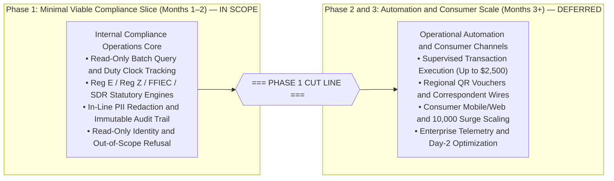
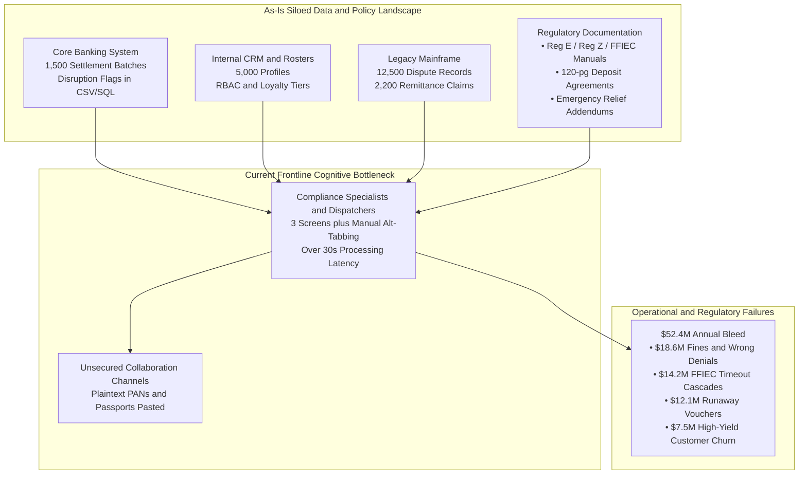
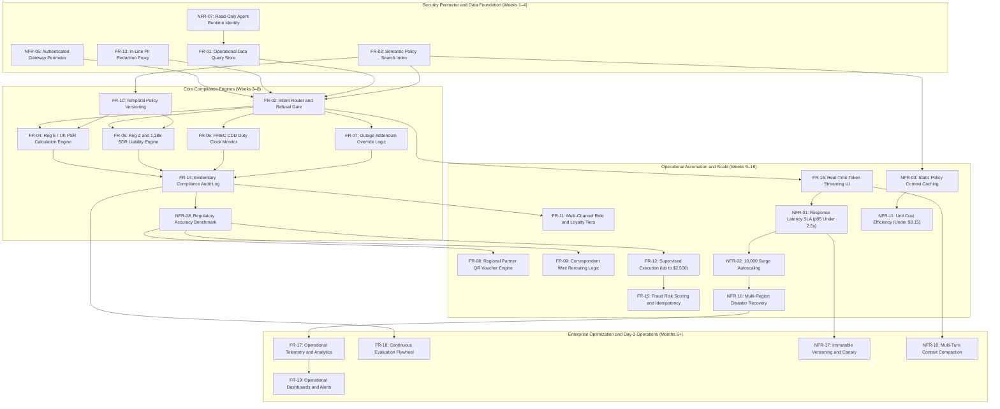

# Discovery Document: Cymbal Bank Autonomous Regulatory Compliance Q&A & Dispute Resolution Assistant

## 1. Document Control

| Field | Value |
| :--- | :--- |
| **Author** | Google Cloud Professional Services / Customer Engineering |
| **Engagement** | Cymbal Bank Autonomous Regulatory Compliance Q&A & Dispute Resolution Assistant |
| **Date** | October 28, 2026 |
| **Version** | 2.0 (Executive Refinement — Problem-Space Neutral & Minimal Slice Focused) |
| **Prioritization Framework** | Hybrid MoSCoW + Weighted Shortest Job First (WSJF) Cost-of-Delay Model |
| **Document Classification** | Highly Confidential — Cymbal Bank & Google Cloud Engagement Team |

### 1.1 Artifact Review Log

| Artifact Filename | Modality | Reviewed? | Requirements Sourced | Key Issues & Evidence Encountered |
| :--- | :--- | :---: | :--- | :--- |
| **00_Customer_Narrative_Brief.md** | Text / Brief | Yes | FR-01–FR-05, FR-11–FR-15, NFR-01–NFR-07, CON-01–CON-06 | Establishes \$52.4M annual ICOPS bleed, 18M customer base, 4 core failure modes, and \$0.15 cost target. |
| **01_Artifact1_Executive_Operational_Call_Transcript.md** | Audio Transcript | Yes | FR-04, FR-06–FR-09, FR-12, FR-14, T-01–T-03, C-01, C-03 | Details Core Outage Orion (\$14M loss), Batch CB-412 FFIEC timeout, B-bucket lockouts, and partner routing. |
| **02_Artifact2_Technical_Security_Architecture_Review.md** | Tech Review Transcript | Yes | NFR-03–NFR-07, NFR-11–NFR-15, CON-01–CON-05, T-02, T-04 | Mandates dual-plane gateway, read-only identity, in-line PII sanitization, prompt injection defenses, and cache flush. |
| **03_INC-882914_nyc_ffiec_cdd_hold_timeout.yaml** | Incident Log (YAML) | Yes | FR-01, FR-03, FR-06, FR-08, NFR-08 | Batch CB-884 FFIEC timeout; \$60,868 voucher overrun due to offline regional partner directory; \$140 NYC cap. |
| **03_INC-883042_lon_nyc_rege_gateway_violation.yaml** | Incident Log (YAML) | Yes | FR-02–FR-04, NFR-08, CON-06 | Batch CB-102 unlawful Force Majeure denial; CFPB/FCA Sanction Warning #CFPB-2025-091; €144k credit + \$250k fine. |
| **03_INC-883199_infosec_dlp_pii_pan_leak.yaml** | Incident Log (YAML) | Yes | FR-13, NFR-05, NFR-13, NFR-14 | Case M4K9P2; unmasked PAN/CVV/Passport leaked into public Slack/tickets; PCI-DSS/GDPR \$500k penalty risk. |
| **03_INC-883250_lax_tyo_regz_remittance_dispute.yaml** | Incident Log (YAML) | Yes | FR-05, FR-10, NFR-08, C-02 | Batch CB-503; 1,288 SDR cap misapplied as \$3,800 domestic cap (\$1,140 bleed) + \$75 unrefunded Reg Z fee. |
| **04_Artifact4_Functional_Whiteboard.jpg** | Visual / Whiteboard | Yes | FR-02, FR-08, FR-09, FR-11, FR-12, FR-14 | Whiteboard architecture: multi-channel ingress, intent routing, statutory verification, and execution paths A/B/C. |
| **04b_Artifact4_Companion_Sizing_Sheet.md** | Sizing Sheet | Yes | NFR-01–NFR-04, NFR-11, CON-07–CON-10 | Defines surge scale (10,000 peak concurrent, 60k queries/day), p95 <= 2.5s SLA, and working data volumes. |
| **05_Artifact5_Serving_Architecture_Performance_Call.md** | Tech Review Transcript | Yes | FR-16, NFR-01, NFR-02, NFR-09–NFR-11, T-01 | Latency budget (2,300ms p95), parallel tool execution, ISO 20022 payload trimming, and multi-region failover. |
| **06_Artifact6_AgentOps_Observability_Call.md** | Tech Review Transcript | Yes | FR-17–FR-19, NFR-17, NFR-18, T-06 | 3-pillar observability (effectiveness, efficiency, tool metrics), human override eval flywheel, and canary rollouts. |
| **Discovery Document Template - NVD.pdf** | Template (PDF) | Yes | Structural Governance | Governs exact 15-section discovery architecture, tabular column schemas, and quality attribute rubrics. |

---

## 2. Executive Summary

### 2.1 The Problem in the Customer's Own Terms
Cymbal Bank Group—a Tier-1 global retail and commercial institution processing 4.2M daily transactions totaling over \$85B in settlement volume—experiences critical operational breakdowns during **Irregular Compliance Operations (ICOPS)** events ([00_Customer_Narrative_Brief.md](file:///Users/ndy/Documents/Antigravity/Elevate/00_Customer_Narrative_Brief.md#L3-L14)). During IT ledger outages, payment-rail brownouts, and gateway timeouts, frontline compliance specialists must navigate fragmented systems and complex regulatory manuals across three separate monitors. Specialists manually Alt-Tab between core ledger screens, 50-page FinCEN directives, and 120-page deposit agreements while processing urgent customer claims ([01_Artifact1_Executive_Operational_Call_Transcript.md](file:///Users/ndy/Documents/Antigravity/Elevate/01_Artifact1_Executive_Operational_Call_Transcript.md#L15-L19)).

This manual cognitive overload causes four severe operational failures:
1. **FFIEC CDD Duty Clock Expirations:** Inability to calculate beneficial-ownership risk profiles within strict statutory compliance duty periods freezes entire settlement queues, creating multi-hub clearing cascades ([01_Artifact1_Executive_Operational_Call_Transcript.md](file:///Users/ndy/Documents/Antigravity/Elevate/01_Artifact1_Executive_Operational_Call_Transcript.md#L17)).
2. **Statutory Misclassification & Unlawful Denials:** Frontline staff routinely misclassify internal hardware/gateway faults as external *Force Majeure*, unlawfully rejecting legitimate claims and triggering severe regulatory sanction warnings ([03_INC-883042_lon_nyc_rege_gateway_violation.yaml](file:///Users/ndy/Documents/Antigravity/Elevate/03_INC-883042_lon_nyc_rege_gateway_violation.yaml#L37)).
3. **Runaway Compensation & Data Leakage:** Panicked agents issue unauthorized third-party bridge wires up to \$600 against a \$140 contracted cap, while copy-pasting unmasked payment card and passport data into public collaboration channels ([03_INC-882914_nyc_ffiec_cdd_hold_timeout.yaml](file:///Users/ndy/Documents/Antigravity/Elevate/03_INC-882914_nyc_ffiec_cdd_hold_timeout.yaml#L41), [03_INC-883199_infosec_dlp_pii_pan_leak.yaml](file:///Users/ndy/Documents/Antigravity/Elevate/03_INC-883199_infosec_dlp_pii_pan_leak.yaml#L21)).
4. **Unsustainable Prototype Costs:** A naive internal prototype injected entire unchunked manuals into every prompt, generating 85,000 tokens per interaction, 8-second latencies, and \$15,000/day cost projections without resolving policy version ambiguities ([00_Customer_Narrative_Brief.md](file:///Users/ndy/Documents/Antigravity/Elevate/00_Customer_Narrative_Brief.md#L58)).

### 2.2 Quantified Business Impact

| Impact Category | Quantified Metric / Exposure | Verifiable Source Citation |
| :--- | :--- | :--- |
| **Total Annual ICOPS Financial Bleed** | **\$52.4M direct annual operational and statutory loss** | [00_Customer_Narrative_Brief.md](file:///Users/ndy/Documents/Antigravity/Elevate/00_Customer_Narrative_Brief.md#L28-L34) |
| — *Statutory Fines & Erroneous Payouts* | **\$18.6M** (35.5% of bleed; misclassified Reg E/Z & SDR liability) | [00_Customer_Narrative_Brief.md](file:///Users/ndy/Documents/Antigravity/Elevate/00_Customer_Narrative_Brief.md#L30) |
| — *FFIEC CDD Hold Cascades & Lockouts* | **\$14.2M** (27.1% of bleed; expired duty clocks & rolled-back queues) | [00_Customer_Narrative_Brief.md](file:///Users/ndy/Documents/Antigravity/Elevate/00_Customer_Narrative_Brief.md#L31) |
| — *Off-Contract Fee Waivers & Overruns* | **\$12.1M** (23.1% of bleed; \$450–\$600 ad-hoc vs. \$120–\$140 caps) | [00_Customer_Narrative_Brief.md](file:///Users/ndy/Documents/Antigravity/Elevate/00_Customer_Narrative_Brief.md#L32) |
| — *High-Yield Account Churn (Executive Platinum)* | **\$7.5M** (14.3% of bleed; >4h 15m hold times & lost deposits) | [00_Customer_Narrative_Brief.md](file:///Users/ndy/Documents/Antigravity/Elevate/00_Customer_Narrative_Brief.md#L33) |
| **Core Outage Orion Event Loss** | **\$14.0M in 4 days**; >600 customer accounts frozen on Batch CB-412 | [01_Artifact1_Executive_Operational_Call_Transcript.md](file:///Users/ndy/Documents/Antigravity/Elevate/01_Artifact1_Executive_Operational_Call_Transcript.md#L11-L19) |
| **Live Enforcement Incident INC-882914** | **\$69,318 net loss** (\$60,868 voucher overrun + \$8,450 stipends) | [03_INC-882914_nyc_ffiec_cdd_hold_timeout.yaml](file:///Users/ndy/Documents/Antigravity/Elevate/03_INC-882914_nyc_ffiec_cdd_hold_timeout.yaml#L45-L48) |
| **Live Enforcement Incident INC-883042** | **€144,000 (\$156,960) unpaid credit + \$250,000 regulatory fine** | [03_INC-883042_lon_nyc_rege_gateway_violation.yaml](file:///Users/ndy/Documents/Antigravity/Elevate/03_INC-883042_lon_nyc_rege_gateway_violation.yaml#L46-L48) |
| **Live Enforcement Incident INC-883199** | **\$500,000 maximum penalty exposure** under PCI-DSS v4.0 & GDPR | [03_INC-883199_infosec_dlp_pii_pan_leak.yaml](file:///Users/ndy/Documents/Antigravity/Elevate/03_INC-883199_infosec_dlp_pii_pan_leak.yaml#L31) |
| **Live Enforcement Incident INC-883250** | **\$1,140 SDR overpayment + \$40,654/violation Reg Z penalty risk** | [03_INC-883250_lax_tyo_regz_remittance_dispute.yaml](file:///Users/ndy/Documents/Antigravity/Elevate/03_INC-883250_lax_tyo_regz_remittance_dispute.yaml#L46-L55) |
| **Target Unit Economics** | **< \$0.15 per resolution** vs. \$18.50 human specialist cost (>99% savings) | [00_Customer_Narrative_Brief.md](file:///Users/ndy/Documents/Antigravity/Elevate/00_Customer_Narrative_Brief.md#L62) |

### 2.3 Top 5 Requirements by Priority

1. **FR-04: Multi-Jurisdictional Statutory Compensation Engine (Reg E / UK PSR) [Must Have]:** Deterministically verify disruption causality (`is_bank_controllable`), invalidate improper *Force Majeure* claims for internal gateway faults, and calculate exact statutory credit tiers (€250/€400/€600) to halt the \$18.6M fine bleed.
2. **FR-06: Real-Time FFIEC BSA/AML CDD Duty Clock Monitor & Alerts [Must Have]:** Continuously calculate remaining compliance review windows (9–14 hours) and generate high-priority operational alerts when clearance margins drop below 30 minutes, preventing batch lockouts.
3. **FR-13: In-Line Bidirectional PII & Payment Card Data Sanitization [Must Have]:** Intercept and redact sensitive financial identifiers (16-digit PANs, CVVs, Passports) prior to reasoning or logging to prevent repeat occurrences of INC-883199 (\$500k penalty risk).
4. **FR-02: Deterministic Intent Router & Out-of-Scope Refusal Gate [Must Have]:** Classify incoming queries into analytical SQL, policy retrieval, or hybrid compliance evaluation, while deterministically refusing off-corpus domains (equities, investment advice).
5. **NFR-07 & NFR-05: Zero-Trust Security Perimeter & Read-Only Runtime Identity [Must Have]:** Enforce authenticated, audience-scoped access boundaries and restrict reasoning agents to read-only analytical access with zero direct ledger modification permissions.

### 2.4 Recommended Phase 1 Scope and the Cut Line
To eliminate delivery risk and address active regulatory penalties immediately, the project establishes a strict, minimal Phase 1 release scope. 

* **In Scope for Phase 1 (Minimal Viable Compliance Slice — Months 1–2):** Exactly 13 core requirements focused exclusively on internal compliance operations:
  * Read-only operational data queries (`FR-01`), intent routing (`FR-02`), policy retrieval (`FR-03`), Reg E/UK PSR calculation (`FR-04`), Reg Z & 1,288 SDR cap evaluation (`FR-05`), FFIEC duty clock monitoring (`FR-06`), outage addendum overrides (`FR-07`), temporal policy versioning (`FR-10`), in-line PII sanitization (`FR-13`), evidentiary audit logging (`FR-14`), zero-trust boundary (`NFR-05`), read-only runtime access (`NFR-07`), and statutory decision accuracy (`NFR-08`).
* **The Phase 1 Cut Line:** All write actions, monetary disbursements, consumer digital channels, and external partner integrations are deferred until the core reasoning engine achieves 100% regulatory precision and passes InfoSec audit.
* **Deferred to Phase 2 (Months 3–4):** Contracted QR fee-waiver vouchers (`FR-08`), correspondent partner rerouting (`FR-09`), multi-channel consumer access (`FR-11`), supervised transaction execution up to \$2,500 (`FR-12`), fraud risk scoring (`FR-15`), and high-concurrency surge scaling (`NFR-02`).
* **Deferred to Phase 3 / Post-Audit (Months 5+):** Autonomous unassisted write execution over \$2,500 (`DEL-02`), unauthenticated kiosk access (`DEL-01`), enterprise Day-2 AgentOps dashboards (`FR-17`, `FR-19`), and continuous evaluation flywheels (`FR-18`).

### 2.5 The Three Things That Must Be Resolved Before Design Can Start
1. **Separation of Reasoning and Transaction Execution (`T-02` / `C-01`):** Reconcile CISO Sam Lin's mandate for a read-only agent runtime with Operations' requirement for automated fee waivers and vouchers.
   * *Resolution:* Enforce strict privilege separation where the reasoning agent operates in a read-only posture and emits structured, validated compensation recommendations to a supervised downstream transaction service.
2. **Correspondent Banking Authorization Scope (`C-03` / `T-03`):** Resolve the contradiction between executive policies prohibiting third-party wire rerouting and operational requirements for alternative clearing during outages.
   * *Resolution:* Restrict correspondent partner rerouting (via JPMorgan Chase, Citibank, HSBC) strictly to Executive Platinum accounts experiencing clearing delays exceeding 12 hours.
3. **Audit Immutability vs. Data Privacy Erasure (`C-06` / `T-05`):** Harmonize the statutory requirement for 5-year immutable compliance audit logs with GDPR/CCPA mandates for consumer data erasure.
   * *Resolution:* Retain only anonymized surrogate tokens in immutable audit logs, maintaining customer-to-token mappings in a separate data store that supports individual cryptographic erasure without altering audit history.

---

## 3. Stakeholder Register

| Name | Role / Title | Key Agenda / Mandate | Sign-Off / Veto Authority | Source Citation |
| :--- | :--- | :--- | :--- | :--- |
| **Sarah Jenkins (SJ)** | Chief Operations Officer (COO) | Eliminate \$52.4M annual bleed, protect \$14M outage exposure, resolve Batch CB-412 lockouts. | **Final Business Sign-Off** on operational deployment and budget. | [01_Artifact1_Executive_Operational_Call_Transcript.md](file:///Users/ndy/Documents/Antigravity/Elevate/01_Artifact1_Executive_Operational_Call_Transcript.md#L11-L14) |
| **Marcus Vance (MV)** | VP of Banking Operations & Disputes | Automate dispute resolution, enforce partner voucher caps (\$140/\$120/€150), enable partner rerouting. | Operational sign-off on workflow automation and voucher rules. | [01_Artifact1_Executive_Operational_Call_Transcript.md](file:///Users/ndy/Documents/Antigravity/Elevate/01_Artifact1_Executive_Operational_Call_Transcript.md#L20-L24) |
| **Elena Voss (EV)** | SVP of Customer Experience | Reduce call wait times from >4h 15m, prevent Executive Platinum churn, provide multi-channel access. | CX sign-off on consumer channel rollouts and user interaction flows. | [00_Customer_Narrative_Brief.md](file:///Users/ndy/Documents/Antigravity/Elevate/00_Customer_Narrative_Brief.md#L45) |
| **Sam Lin (SL)** | Chief Information Security Officer (CISO) | Zero-trust gateway enforcement, read-only agent identity, in-line PII sanitization, prompt injection blocks. | **Absolute Security Veto** over production launch and architecture. | [02_Artifact2_Technical_Security_Architecture_Review.md](file:///Users/ndy/Documents/Antigravity/Elevate/02_Artifact2_Technical_Security_Architecture_Review.md#L15-L22) |
| **Rachel Sterling (RS)** | VP of Regulatory Affairs & Legal Counsel | 100% compliance with Reg E, Reg Z, FFIEC CDD, and SDR caps; resolve CFPB Sanction #CFPB-2025-091. | **Absolute Legal & Compliance Veto** on statutory logic and audit trails. | [01_Artifact1_Executive_Operational_Call_Transcript.md](file:///Users/ndy/Documents/Antigravity/Elevate/01_Artifact1_Executive_Operational_Call_Transcript.md#L21-L24) |
| **Aris Thorne (AT)** | VP of Enterprise Architecture | Zero point-to-point integration, temporal policy versioning, payload trimming, enterprise governance. | Technical architecture sign-off on integration standards. | [02_Artifact2_Technical_Security_Architecture_Review.md](file:///Users/ndy/Documents/Antigravity/Elevate/02_Artifact2_Technical_Security_Architecture_Review.md#L40-L45) |
| **Carlos Mendez (CM)** | Principal AI Platform Architect | p95 latency <= 2.5s, 10,000 surge concurrency, multi-region failover (RTO < 60s, RPO = 0). | Platform engineering sign-off on infrastructure and serving design. | [05_Artifact5_Serving_Architecture_Performance_Call.md](file:///Users/ndy/Documents/Antigravity/Elevate/05_Artifact5_Serving_Architecture_Performance_Call.md#L7-L14) |
| **Dana Hughes (DH)** | Director of Cloud FinOps | Enforce < \$0.15 unit economics, eliminate \$15k/day prototype burn, implement static context caching. | FinOps sign-off on operational costs and model routing strategy. | [04b_Artifact4_Companion_Sizing_Sheet.md](file:///Users/ndy/Documents/Antigravity/Elevate/04b_Artifact4_Companion_Sizing_Sheet.md#L15), [05_Artifact5_Serving_Architecture_Performance_Call.md](file:///Users/ndy/Documents/Antigravity/Elevate/05_Artifact5_Serving_Architecture_Performance_Call.md#L12) |
| **Elena Rostova (ER)** | Director of Compliance Ops Center | Eliminate manual Alt-Tabbing across 3 monitors, resolve CDP duty clock timeouts, enforce voucher limits. | User acceptance sign-off for Compliance Operations Center dispatchers. | [01_Artifact1_Executive_Operational_Call_Transcript.md](file:///Users/ndy/Documents/Antigravity/Elevate/01_Artifact1_Executive_Operational_Call_Transcript.md#L15-L19) |
| **Priya Nair (PN)** | Head of Core Banking Integration | Protect core ledger from unpruned scans, enforce partition queries, integrate ISO 20022 messaging. | Core banking integration sign-off on backend ledger connectors. | [02_Artifact2_Technical_Security_Architecture_Review.md](file:///Users/ndy/Documents/Antigravity/Elevate/02_Artifact2_Technical_Security_Architecture_Review.md#L35-L39) |

### 3.1 Stakeholder Tensions to be Reconciled

| Tension # | Position A (Stakeholder + Citation) | Position B (Stakeholder + Citation) | Recommended Resolution / Default | Decision Owner |
| :--- | :--- | :--- | :--- | :--- |
| **T-01: Cost vs. Latency vs. Reasoning Depth** | **Dana Hughes (FinOps):** Demands strict < \$0.15 cost ceiling and static prompt caching to stop \$15k/day burn. ([05_Artifact5_Serving_Architecture_Performance_Call.md#L12](file:///Users/ndy/Documents/Antigravity/Elevate/05_Artifact5_Serving_Architecture_Performance_Call.md#L12)) | **Carlos Mendez (AI Arch):** Requires deep multi-hop reasoning models to ensure 100% statutory precision. ([05_Artifact5_Serving_Architecture_Performance_Call.md#L14](file:///Users/ndy/Documents/Antigravity/Elevate/05_Artifact5_Serving_Architecture_Performance_Call.md#L14)) | Route simple queries and routing (70%) to lightweight models with cached context, reserving high-capacity models (30%) for complex statutory calculations. | Dana Hughes & Carlos Mendez |
| **T-02: Security Read-Only Identity vs. Write Autonomy** | **Sam Lin (CISO):** Demands 100% read-only agent service account with zero direct write permissions to banking ledgers. ([02_Artifact2_Technical_Security_Architecture_Review.md#L18](file:///Users/ndy/Documents/Antigravity/Elevate/02_Artifact2_Technical_Security_Architecture_Review.md#L18)) | **Marcus Vance (Ops):** Demands autonomous execution of fee waivers and vouchers up to \$2,500 without human intervention. ([01_Artifact1_Executive_Operational_Call_Transcript.md#L28](file:///Users/ndy/Documents/Antigravity/Elevate/01_Artifact1_Executive_Operational_Call_Transcript.md#L28)) | Maintain read-only agent reasoning identity; emit signed compensation intents to an isolated transaction execution service enforcing strict authorization. | Sam Lin & Marcus Vance |
| **T-03: Correspondent Rail Rerouting Authorization** | **Sarah Jenkins (COO):** Notes general bank policy prohibits rerouting customers onto third-party correspondent rails. ([01_Artifact1_Executive_Operational_Call_Transcript.md#L12](file:///Users/ndy/Documents/Antigravity/Elevate/01_Artifact1_Executive_Operational_Call_Transcript.md#L12)) | **Marcus Vance (Ops):** Partner rerouting via JPMorgan, Citi, and HSBC is operationally necessary for premium accounts. ([01_Artifact1_Executive_Operational_Call_Transcript.md#L30](file:///Users/ndy/Documents/Antigravity/Elevate/01_Artifact1_Executive_Operational_Call_Transcript.md#L30)) | Restrict partner wire rerouting strictly to Executive Platinum accounts experiencing verified bank-controllable delays > 12 hours. | Sarah Jenkins |
| **T-04: Adversarial Refusal vs. Customer Deflection** | **Sam Lin (CISO):** Mandates strict refusal gates for prompt injection and out-of-scope requests with 100% block rate. ([02_Artifact2_Technical_Security_Architecture_Review.md#L30](file:///Users/ndy/Documents/Antigravity/Elevate/02_Artifact2_Technical_Security_Architecture_Review.md#L30)) | **Elena Voss (CX):** Warns that aggressive refusal filters will falsely deflect frustrated customers, driving churn. ([00_Customer_Narrative_Brief.md#L47](file:///Users/ndy/Documents/Antigravity/Elevate/00_Customer_Narrative_Brief.md#L47)) | Implement a 3-tier boundary: clear requests processed automatically, borderline/frustrated queries warm-transferred to specialists, adversarial attacks refused. | Sam Lin & Elena Voss |
| **T-05: 5-Year Audit Immutability vs. Privacy Erasure** | **Rachel Sterling (Legal):** Mandates 5-year tamper-evident audit retention of every prompt, citation, and determination. ([01_Artifact1_Executive_Operational_Call_Transcript.md#L34](file:///Users/ndy/Documents/Antigravity/Elevate/01_Artifact1_Executive_Operational_Call_Transcript.md#L34)) | **Sam Lin (CISO):** Mandates strict GDPR/CCPA compliance, requiring complete erasure of personal data upon request. ([02_Artifact2_Technical_Security_Architecture_Review.md#L22](file:///Users/ndy/Documents/Antigravity/Elevate/02_Artifact2_Technical_Security_Architecture_Review.md#L22)) | Store only surrogate tokens in immutable audit records; maintain identity mappings in an isolated database supporting per-customer key deletion. | Rachel Sterling & Sam Lin |
| **T-06: Continuous Learning vs. Production Stability** | **Carlos Mendez (AI Arch):** Requests automated retraining flywheels using supervisor override logs to update model behaviors. ([06_Artifact6_AgentOps_Observability_Call.md#L25](file:///Users/ndy/Documents/Antigravity/Elevate/06_Artifact6_AgentOps_Observability_Call.md#L25)) | **Sam Lin (CISO):** Prohibits unverified runtime model updates, requiring strict versioning, regression testing, and sign-offs. ([02_Artifact2_Technical_Security_Architecture_Review.md#L88](file:///Users/ndy/Documents/Antigravity/Elevate/02_Artifact2_Technical_Security_Architecture_Review.md#L88)) | Overrides and feedback feed an offline evaluation pipeline; model/prompt bundles remain strictly immutable and release via audited canary deployments. | Sam Lin & Carlos Mendez |
| **T-07: Legacy Policy Manual Removal vs. Dispute Audit** | **Aris Thorne (Arch):** Demands immediate deletion of legacy 2022 deposit manuals to stop \$1,140 SDR overpayment leaks. ([03_INC-883250_lax_tyo_regz_remittance_dispute.yaml#L52](file:///Users/ndy/Documents/Antigravity/Elevate/03_INC-883250_lax_tyo_regz_remittance_dispute.yaml#L52)) | **Rachel Sterling (Legal):** Historical disputes for past transaction dates legally require referencing the agreement in effect at that time. ([01_Artifact1_Executive_Operational_Call_Transcript.md#L32](file:///Users/ndy/Documents/Antigravity/Elevate/01_Artifact1_Executive_Operational_Call_Transcript.md#L32)) | Retain historical manuals in knowledge base with explicit temporal metadata tags, filtering active searches strictly by transaction settlement date. | Rachel Sterling & Aris Thorne |
| **T-08: DevSecOps Gates vs. Rapid Outage Hotfixes** | **Sam Lin (CISO):** Mandates blocking CI/CD security scans that prevent deployment if any high-severity issue exists. ([02_Artifact2_Technical_Security_Architecture_Review.md#L92](file:///Users/ndy/Documents/Antigravity/Elevate/02_Artifact2_Technical_Security_Architecture_Review.md#L92)) | **Marcus Vance (Ops):** Demands capability to update policy rules within 1 hour during live operational emergencies. ([01_Artifact1_Executive_Operational_Call_Transcript.md#L25](file:///Users/ndy/Documents/Antigravity/Elevate/01_Artifact1_Executive_Operational_Call_Transcript.md#L25)) | Decouple regulatory policy content ingestion from application code pipelines, allowing audited policy updates via fast-track administrative pipelines. | Sam Lin & Marcus Vance |
| **T-09: Unauthenticated Kiosk Access vs. Anti-Fraud** | **Elena Voss (CX):** Requests walk-up guest lookup at branch kiosks using name and date of birth to assist customers. ([04_Artifact4_Functional_Whiteboard.jpg](file:///Users/ndy/Documents/Antigravity/Elevate/04_Artifact4_Functional_Whiteboard.jpg)) | **Sam Lin (CISO):** Prohibits unauthenticated account lookups, requiring multi-factor authentication to prevent identity theft. ([02_Artifact2_Technical_Security_Architecture_Review.md#L16](file:///Users/ndy/Documents/Antigravity/Elevate/02_Artifact2_Technical_Security_Architecture_Review.md#L16)) | Defer unauthenticated kiosk access to Phase 3; require authenticated mobile app or staff-assisted dual-verification for kiosk interactions. | Sam Lin & Elena Voss |
| **T-10: Autonomous Settlement Execution Thresholds** | **Marcus Vance (Ops):** Requests automated processing for all valid claims within the \$2,500 domestic limit. ([01_Artifact1_Executive_Operational_Call_Transcript.md#L28](file:///Users/ndy/Documents/Antigravity/Elevate/01_Artifact1_Executive_Operational_Call_Transcript.md#L28)) | **Rachel Sterling (Legal):** Cross-border remittance disputes are governed by a distinct 1,288 SDR (~\$1,710) statutory ceiling. ([03_INC-883250_lax_tyo_regz_remittance_dispute.yaml#L48](file:///Users/ndy/Documents/Antigravity/Elevate/03_INC-883250_lax_tyo_regz_remittance_dispute.yaml#L48)) | Enforce jurisdiction-specific thresholds: autonomous execution capped at \$500; \$500.01 to \$1,710 (SDR) or \$2,500 (Domestic) requires 1-click supervisor sign-off. | Rachel Sterling |

---

## 4. Business Context & Value Drivers

### 4.1 Current State and Why Existing Systems Cannot Solve It

1. **Information Silos Across Relational and Document Stores:** Settlement statuses and disruption causality flags sit in core banking databases; customer loyalty tiers and staff authorization levels exist in CRM platforms; remittance records reside in legacy mainframes; and fee-waiver policies are trapped in 120-page manuals ([00_Customer_Narrative_Brief.md#L55](file:///Users/ndy/Documents/Antigravity/Elevate/00_Customer_Narrative_Brief.md#L55)).
2. **Cognitive Overload During Operational Crises:** During an outage, specialists must simultaneously evaluate transactional data and complex legal frameworks across three screens. They fail to compute FFIEC CDD duty clocks within required timeframes and overlook emergency fee-waiver addendums, leading to unlawful claim denials ([01_Artifact1_Executive_Operational_Call_Transcript.md#L15-L25](file:///Users/ndy/Documents/Antigravity/Elevate/01_Artifact1_Executive_Operational_Call_Transcript.md#L15-L25)).
3. **Insecure Ad-Hoc Communication Workarounds:** When standard systems experience delays, staff share unencrypted payment card account numbers and passport identifiers across general chat channels and incident tickets ([03_INC-883199_infosec_dlp_pii_pan_leak.yaml#L21-L28](file:///Users/ndy/Documents/Antigravity/Elevate/03_INC-883199_infosec_dlp_pii_pan_leak.yaml#L21-L28)).
4. **Flawed Prototype Architecture:** An early internal attempt injected entire unpartitioned manuals into model prompts, causing extreme token costs (\$800 in 2 hours), latency exceeding 8 seconds, and policy hallucinations ([00_Customer_Narrative_Brief.md#L58](file:///Users/ndy/Documents/Antigravity/Elevate/00_Customer_Narrative_Brief.md#L58)).

### 4.2 Regulatory and Legal Landscape

| Regulatory Regime / Statute | Governing Mandate & Precedent | Core Rules, Thresholds & Statutory Caps | Enforcement Authorities & Penalties |
| :--- | :--- | :--- | :--- |
| **Regulation E (12 CFR Part 1005) & UK/EU PSR** | CFPB Circular 2024-05; CJEU *Wallentin-Hermann* Doctrine (Case C-549/07) | • Clearing delays > 3 hours or unauthorized EFT claims mandate fixed provisional credits by exposure index: **€250/\$250** (<1,500), **€400/\$400** (1,500–3,500), or **€600/\$600** (>3,500; £520 UK equiv). • Internal gateway faults and technical failures are **strictly bank-controllable** and never constitute *Force Majeure*. | **US CFPB & UK FCA** (Formal Sanction Warning #CFPB-2025-091; \$250k penalty on Batch CB-102). |
| **Regulation Z (12 CFR Part 1026, 2024 Mandates)** | 12 CFR § 1026.13(e) (Fair Credit Billing) | • Mandatory automatic refund within **7 business days** (electronic) or **20 days** (check) when settlement is delayed > 3 hours (domestic) or > 6 hours (international) and alternative routing is declined. • Automatic refund of paid ancillary fees (**\$75**) on verification delays > 12h domestic / > 15–30h international. • Unauthorized credit billing liability strictly capped at **\$50**. | **US CFPB & OCC** (Strict-liability civil money penalties up to **\$40,654 per violation**). |
| **Cross-Border Remittance Convention (Reg E Subpart B)** | International SDR Convention / Deposit Manual v2024.4 | • International remittance delay and multi-currency billing error liability is strictly capped at **1,288 Special Drawing Rights (SDR)** per transaction (**~\$1,700–\$1,710 USD**). • Supersedes domestic provisional credit limits (\$3,800 domestic cap). | **US CFPB & International Authorities** (\$1,140 overpayment leakage per claim in INC-883250). |
| **FFIEC BSA/AML Manual (31 CFR Parts 1010/1020)** | FFIEC CDD Examination Standards | • Enforces strict Compliance Duty Period (CDP) hold windows (**9–14 hours** based on risk tier). • Expiration triggers an immediate statutory freeze, requiring manual queue rollback and re-review. Proactive alerting required when margin is **< 30 minutes**. | **FinCEN, OFAC, FFIEC & OCC** (Mandatory statutory clearing freeze and rollback). |
| **Data Privacy & Payment Security Standards** | PCI-DSS v4.0 Req 3.4/4.2; GLBA; GDPR Art. 17/32; CCPA | • Prohibits unencrypted transmission and logging of 16-digit PANs, CVVs, Passports, and SSNs. • Requires regional data residency controls and consumer right-to-erasure compliance. | **PCI SSC, FTC, EU/UK DPAs, CPPA** (\$500k penalty exposure in INC-883199). |

### 4.3 Active Enforcement and Live Incidents
1. **Core Outage Orion (Batch CB-412 — NYC Hub):** A four-day infrastructure outage generated **\$14.0M in direct losses**. Batch CB-412 sat in the clearing queue with 28 minutes remaining on its FFIEC hold clock; manual review delays caused the clock to expire, triggering a 2-hour statutory freeze, rolling back to Queue B12, blocking 3 downstream clearing sweeps, and **freezing over 600 accounts** ([01_Artifact1_Executive_Operational_Call_Transcript.md#L11-L19](file:///Users/ndy/Documents/Antigravity/Elevate/01_Artifact1_Executive_Operational_Call_Transcript.md#L11-L19)).
2. **INC-882914 (Batch CB-884 — NYC to CLT):** Batch CB-884 timed out due to an expired FFIEC review window. With regional partner fee schedules unavailable locally, staff instructed 178 customers to purchase third-party bridge wires (averaging \$482 vs. the \$140 contracted cap), resulting in **\$85,796 in claims against a \$24,920 budget (\$60,868 net overrun)** and **\$8,450 in unauthorized stipends** ([03_INC-882914_nyc_ffiec_cdd_hold_timeout.yaml#L15-L49](file:///Users/ndy/Documents/Antigravity/Elevate/03_INC-882914_nyc_ffiec_cdd_hold_timeout.yaml#L15-L49)).
3. **INC-883042 (Batch CB-102 — LON to NYC):** A 4-hour internal authentication gateway failure coincided with a localized 30-minute telecom squall. Specialists improperly cited the weather note to reject all 240 statutory claims under *Force Majeure*, resulting in **CFPB/FCA Sanction Warning #CFPB-2025-091**, exposing the bank to **€144,000 in unpaid compensation** and **\$250,000 in projected fines** ([03_INC-883042_lon_nyc_rege_gateway_violation.yaml#L15-L48](file:///Users/ndy/Documents/Antigravity/Elevate/03_INC-883042_lon_nyc_rege_gateway_violation.yaml#L15-L48)).
4. **INC-883199 (Case M4K9P2 — NYC Hub):** A contract specialist handling an urgent compensation claim for an Executive Platinum client pasted an unmasked 16-digit Visa PAN, CVV, expiration date, and US passport number into a public Slack channel (410 members) and ticket, where it remained exposed for over 3 hours, carrying a **\$500,000 regulatory penalty risk** ([03_INC-883199_infosec_dlp_pii_pan_leak.yaml#L15-L32](file:///Users/ndy/Documents/Antigravity/Elevate/03_INC-883199_infosec_dlp_pii_pan_leak.yaml#L15-L32)).
5. **INC-883250 (Batch CB-503 — LAX to TYO):** A specialist evaluating an international wire delay applied the US domestic deposit dispute cap (\$3,800) instead of the international convention limit (1,288 SDR / \$1,710), causing **\$1,140 in overpayment leakage**, while failing to refund the mandatory **\$75 ancillary investigation fee**, triggering a **\$40,654 statutory violation exposure** ([03_INC-883250_lax_tyo_regz_remittance_dispute.yaml#L15-L55](file:///Users/ndy/Documents/Antigravity/Elevate/03_INC-883250_lax_tyo_regz_remittance_dispute.yaml#L15-L55)).

---

## 5. Functional Requirements Register

| Req ID | Functional Requirement Statement | Source Artifact | Locator | Verbatim Quote | Acceptance Criteria | Priority | Priority Justification |
| :--- | :--- | :--- | :--- | :--- | :--- | :---: | :--- |
| **FR-01** | The system shall execute read-only queries against operational settlement records and dispute logs to aggregate batch processing statuses, clearing delay durations, and FFIEC CDP compliance margins dynamically. | `INC-882914` `Artifact 1` `Artifact 4b` | `INC-882914`: L54–55 `Art 1`: [00:06:35] `Art 4b`: Row 4 | *"Implement a read-only analytical SQL execution tool allowing the reasoning engine to aggregate settlement batch statuses, clearing delay minutes, and FFIEC CDP duty margins dynamically."* | 1. Queries return accurate status and delay minutes across 100% of structured test records. 2. Execution operates under read-only permissions with zero data modification capability. 3. Aggregates duty clearance margins without executing table-wide unpruned scans. | **Must Have** | Foundational data access capability required to calculate FFIEC hold margins and identify disrupted batches (`INC-882914`). |
| **FR-02** | The system shall classify incoming user requests into deterministic routing categories (analytical data query, statutory policy retrieval, hybrid compliance reasoning, or out-of-scope refusal) and reject unapproved domains. | `INC-883042` `Artifact 0` `Artifact 2` | `INC-883042`: L54–55 `Art 0`: §1.5, L65 `Art 2`: [00:06:28] | *"Implement a deterministic 3-Way Intent Router capable of distinguishing Pure Analytical SQL queries, Pure Regulatory Policy lookups, and Hybrid Multi-Hop compliance resolutions, while enforcing refusal gates."* | 1. Achieves >= 90% routing precision across benchmark evaluation test cases. 2. 100% rejection rate for out-of-scope topics (equities trading, investment advice, tax structuring). 3. Borderline customer queries are routed to human queues rather than falsely rejected. | **Must Have** | Core routing capability preventing hallucinations and enforcing mandatory security refusal boundaries (`CON-06`). |
| **FR-03** | The system shall perform semantic retrieval across active regulatory manuals and deposit agreements, preserving statutory compensation matrices (€250/€400/€600 tiers, fee caps) intact within retrieved context segments. | `INC-883042` `INC-882914` `Artifact 0` | `INC-883042`: L52–53 `INC-882914`: L56 `Art 0`: §1.4, L56 | *"Configure document chunking at 500 tokens with a 100-token overlap so statutory exposure-to-compensation matrices remain intact within retrieved segments."* | 1. Preserves statutory compensation matrices intact across 100% of policy query retrievals. 2. Semantic searches return source document, section, and publication date metadata. 3. Chunks respect paragraph and table boundaries to avoid fragmented rules. | **Must Have** | Enables policy ground-truth retrieval, eliminating prototype hallucinations and rule misinterpretations (`INC-883042`). |
| **FR-04** | The system shall evaluate electronic fund transfer delays against statutory Reg E and UK/EU PSR thresholds, verify disruption causality (`is_bank_controllable`), override force majeure claims for internal technical failures, and determine mandatory provisional credit amounts. | `Artifact 0` `Artifact 1` `INC-883042` `Artifact 4b` | `Art 0`: §1.3, L38–39 `Art 1`: [00:03:42] `INC-883042`: L31–48 `Art 4b`: Row 6 | *"Ensure 100% decision precision on hybrid multi-hop edge cases: for Batch CB-102, the agent must verify is_bank_controllable = TRUE, reject telecom/weather force majeure, and award €600 statutory provisional credit."* | 1. 100% accuracy on Reg E test cases, correctly identifying bank-controllable causality. 2. Internal gateway and hardware failures are never classified as Force Majeure. 3. Calculates exact statutory tiers: €250/\$250 (<1,500), €400/\$400 (1,500–3,500), €600/\$600 (>3,500). | **Must Have** | Directly resolves CFPB/FCA Sanction Warning #CFPB-2025-091 and halts \$18.6M annual statutory fine bleed. |
| **FR-05** | The system shall evaluate cross-border remittance disputes against statutory Reg Z and international convention rules, capping liability at 1,288 SDR (~\$1,710 USD) and automatically determining eligibility for refund of paid ancillary fees on delayed verifications. | `INC-883250` `Artifact 1` `Artifact 4b` | `INC-883250`: L48–55 `Art 1`: [00:04:19] `Art 4b`: Row 6 | *"Strictly cap international remittance delay liability at 1,288 SDR (~\$1,710.00 USD) and ensure mandatory refund of paid ancillary wire investigation fees (\$75.00) under Reg Z 12 CFR § 1026.13(e)."* | 1. Enforces 1,288 SDR liability cap on all cross-border remittance error claims. 2. Automatically adds \$75 ancillary fee refund for verification delays exceeding statutory limits. 3. Rejects domestic \$3,800 cap on international claims with 100% accuracy in eval benchmarks. | **Must Have** | Halts \$1,140/claim overpayment leakage and avoids \$40,654/violation strict-liability Reg Z penalties (`INC-883250`). |
| **FR-06** | The system shall calculate remaining FFIEC BSA/AML Customer Due Diligence hold duty windows (9–14 hours based on risk tier) and trigger operational alerts when remaining compliance clearance time falls below 30 minutes. | `INC-882914` `Artifact 1` `Artifact 4b` | `INC-882914`: L50–53 `Art 1`: [00:02:45] `Art 4b`: Row 5 | *"Track remaining Compliance Duty Period (CDP) time windows dynamically and alert the Compliance Operations Center (COC) dispatch when remaining clearance margin drops below 30 minutes."* | 1. Computes remaining hold windows dynamically across all active settlement batches. 2. Generates high-priority alerts within 60 seconds when remaining margin drops below 30 minutes. 3. Identifies qualified relief officers in staffing rosters when duty windows near expiration. | **Must Have** | Eliminates FFIEC CDD hold expirations that cause multi-hub batch clearing cascades (\$14.2M annual loss). |
| **FR-07** | The system shall apply executive regulatory relief addendums to waive fees and override standard basic account restrictions during declared operational outage events. | `Artifact 1` `INC-882914` `Artifact 4b` | `Art 1`: [00:05:12] `INC-882914`: L40 `Art 4b`: Row 7 | *"Ensure the agent applies EXECUTIVE_REGULATORY_RELIEF_AND_FEE_WAIVER_ADDENDUM_2025_Q1 to override standard Basic Checking (B-bucket) fee-waiver locks during active ICOPS events."* | 1. Successfully identifies declared ICOPS outage states from operational logs. 2. Overrides normal basic account locks to authorize legitimate fee waivers during outages. 3. Logs exact governing executive addendum citation for every authorized override. | **Must Have** | Prevents unlawful customer fee-waiver rejections during core-banking ledger outages (`Artifact 1`). |
| **FR-08** | The system shall issue capped, tamper-evident digital fee-waiver vouchers (\$140 NYC, \$120 CLT, €150 LON) and daily customer care stipends (\$65 Executive Platinum, \$40 General) aligned with regional partner agreements. | `INC-882914` `Artifact 1` `Artifact 4b` | `INC-882914`: L42–48 `Art 1`: [00:05:45] `Art 4b`: Row 8 | *"Enforce contracted regional fee-waiver caps (\$140 NYC, \$120 CLT, €150 LON) and automate issuance of contracted QR fee-waiver vouchers to stop ad-hoc \$450–\$600 overpayments."* | 1. Restricts generated voucher values to exact contracted regional hub caps. 2. Restricts daily customer care stipends to policy limits based on loyalty tier. 3. Generates unique, tamper-evident digital vouchers with expiration timestamps. | **Should Have** | Eliminates \$12.1M annual off-contract voucher overages and stops ad-hoc \$450–\$600 payouts (`INC-882914`). |
| **FR-09** | The system shall generate alternative settlement routing proposals across contracted correspondent partner institutions (JPMorgan Chase, Citibank, HSBC) for eligible premium accounts experiencing severe clearing delays. | `Artifact 1` `Artifact 4` `Artifact 4b` | `Art 1`: [00:06:10] `Art 4`: Path A `Art 4b`: Row 9 | *"Support partner wire rerouting proposals across contracted correspondent institutions (JPMorgan Chase, Citibank, HSBC) for eligible Executive Platinum accounts."* | 1. Verifies customer eligibility (Executive Platinum or delay > 12h) before proposing reroute. 2. Selects only from pre-approved correspondent institutions with active clearing agreements. 3. Formats proposed settlement instructions adhering to ISO 20022 message specifications. | **Should Have** | Mitigates high-yield corporate customer defection (\$7.5M annual churn) during prolonged payment-rail freezes. |
| **FR-10** | The system shall enforce temporal metadata filtering to evaluate compliance disputes strictly against the policy version active on the transaction settlement date, preventing cross-version policy leakage. | `INC-883250` `Artifact 1` `Artifact 2` | `INC-883250`: L50–53 `Art 1`: [00:04:45] `Art 2`: [00:05:15] | *"Implement temporal metadata filtering on policy knowledge bases (is_active = TRUE) to ensure historical disputes are evaluated strictly against policies in effect at transaction time."* | 1. Restricts policy retrieval to documents active on the specific transaction settlement date. 2. Completely isolates active 2024 manuals from archived legacy 2022 versions. 3. Correctly resolves conflicting terms by prioritizing active addendums over base manuals. | **Must Have** | Eliminates policy version confusion that caused \$1,140 overpayment leakage per claim in INC-883250. |
| **FR-11** | The system shall restrict data access and operational actions according to authenticated user role (Analyst, Senior Counsel, Audit Reviewer) and customer loyalty tier (Executive Platinum through General Member). | `Artifact 0` `Artifact 2` `Artifact 4b` | `Art 0`: §1.2, L24 `Art 2`: [00:02:15] `Art 4b`: Row 2 | *"Enforce role-based access control across internal user tiers (Analyst, Senior Counsel, Audit Reviewer) and honor customer loyalty hierarchies across all interaction channels."* | 1. Restricts sensitive administrative views and override capabilities to authorized roles. 2. Tailors service responses and entitlements according to customer loyalty tier. 3. Rejects unauthorized access attempts with standard security event logging. | **Should Have** | Protects internal workflows, ensures regulatory segregation of duties, and enforces account entitlements. |
| **FR-12** | The system shall automatically route transactions exceeding \$2,500, claims involving high fraud risk, or customer hardship cases to human compliance officers, while enabling automated processing for pre-authorized low-risk actions. | `Artifact 1` `Artifact 4` `Artifact 4b` | `Art 1`: [00:05:30] `Art 4`: Path C `Art 4b`: Row 10 | *"Enforce mandatory Human-in-the-Loop (HITL) escalation for claims exceeding \$2,500, accounts with fraud risk scores > 0.80, and sensitive customer hardship claims."* | 1. 100% of transactions > \$2,500 are routed to Senior Counsel queues with full context packets. 2. Claims with fraud scores > 0.80 or hardship flags trigger immediate human review routing. 3. Transactions within pre-authorized thresholds (<= \$500) process without manual intervention. | **Should Have** | Ensures human supervision over high-value capital movements while automating routine dispute volume. |
| **FR-13** | The system shall sanitize incoming text to redact or mask sensitive personal and financial identifiers (16-digit PANs, CVVs, Passports, SSNs) prior to processing or logging, restoring authorized identifiers only on approved outbound responses. | `INC-883199` `Artifact 0` `Artifact 2` | `INC-883199`: L33–36 `Art 0`: §1.5, L66 `Art 2`: [00:03:45] | *"Implement in-line bidirectional PII and payment card tokenization, masking PANs, CVVs, Passports, and SSNs before messages reach reasoning models or audit logs."* | 1. 100% redaction of 16-digit PANs, CVVs, Passports, and SSNs from inbound inputs before reasoning. 2. Audit logs and model context never store unmasked personal financial identifiers. 3. Reversible token lookup restricted strictly to authenticated outbound customer messaging. | **Must Have** | Directly remediates Sev-1 incident INC-883199, preventing \$500k fines under PCI-DSS v4.0 and GDPR. |
| **FR-14** | The system shall record an immutable, tamper-evident evidentiary audit trail of all compliance determinations, retrieved policy citations, and reasoning steps, retaining records for a minimum of 5 years. | `Artifact 1` `Artifact 2` `Artifact 4b` | `Art 1`: [00:07:05] `Art 2`: [00:04:30] `Art 4b`: Row 11 | *"Persist an immutable, tamper-evident audit record of every query, retrieved policy chunk, reasoning graph, and resolution intent for a mandatory 5-year retention period."* | 1. Persists timestamped records of input queries, retrieved policy chunks, and final determinations. 2. Stored records are tamper-evident and protected against deletion or modification for 5 years. 3. Generates complete audit export reports for regulatory review within 5 minutes of request. | **Must Have** | Satisfies mandatory statutory compliance examination rules across US CFPB, OCC, and UK FCA regimes. |
| **FR-15** | The system shall verify customer dispute risk scores and enforce transactional idempotency locks to prevent duplicate compensation claims across simultaneous channels. | `Artifact 0` `Artifact 1` `Artifact 4b` | `Art 0`: §1.3, L41 `Art 1`: [00:05:40] `Art 4b`: Row 10 | *"Enforce dispute risk score verification and transactional idempotency locking to prevent concurrent duplicate claims on identical settlement batches."* | 1. Queries fraud and dispute risk scores prior to authorizing compensation or fee waivers. 2. Rejects duplicate claims for identical transaction references across all channels. 3. Maintains transactional idempotency to prevent double-credit execution during surge retries. | **Should Have** | Protects the bank against coordinated fraud and duplicate payout exploitation during chaotic outage periods. |
| **FR-16** | The system shall deliver incremental token streaming responses to the user interface and trim verbose financial messaging payloads to core transaction attributes prior to reasoning. | `Artifact 5` `Artifact 4b` | `Art 5`: [00:08:15] `Art 4b`: Row 12 | *"Implement progressive token streaming over WebSocket/SSE to achieve time-to-first-token < 800ms, and trim verbose ISO 20022 payloads to essential routing attributes."* | 1. Initiates progressive response rendering to client interfaces with TTFT < 800ms. 2. Strips non-essential XML/JSON wrapper fields from ISO 20022 payloads prior to model ingestion. 3. Reduces raw message token footprint by >= 75% while retaining core clearing identifiers. | **Should Have** | Essential for meeting the p95 <= 2.5s latency SLA and keeping token volumes within unit cost targets. |
| **FR-17** | The system shall capture operational telemetry covering task completion rates, resolution precision, query costs, latency distributions, and tool execution success rates. | `Artifact 6` `Artifact 4b` | `Art 6`: [00:02:10] `Art 4b`: Row 13 | *"Capture operational metrics across three core pillars: Effectiveness (task completion, routing precision), Efficiency (cost per query, latency), and Tool Performance (execution success)."* | 1. Records latency, token count, cost, and routing category for 100% of processed interactions. 2. Aggregates tool execution success and failure rates with granular error classification. 3. Emits distributed tracing metadata allowing end-to-end request reconstruction. | **Could Have** | Provides operational visibility into system performance and cost efficiency, supporting Day-2 tuning. |
| **FR-18** | The system shall capture human reviewer overrides and representative resolution samples to support systematic offline accuracy regression testing. | `Artifact 6` `Artifact 2` | `Art 6`: [00:04:45] `Art 2`: [00:08:10] | *"Capture 100% of human supervisor overrides and a 5% random audit sample of automated resolutions to continuously refresh golden evaluation benchmarks."* | 1. Automatically records all instances where a human supervisor overrides an automated recommendation. 2. Assembles sanitized evaluation datasets for periodic offline regression testing. 3. Prohibits direct unverified model retraining in production environments. | **Could Have** | Drives continuous accuracy improvements while protecting production stability through strict evaluation gates. |
| **FR-19** | The system shall provide operational monitoring views displaying compliance clearance volumes, hold clock statuses, and automated anomaly alerts for sudden spikes in reviewer overrides or processing latency. | `Artifact 6` `Artifact 1` | `Art 6`: [00:06:30] `Art 1`: [00:06:50] | *"Deliver role-tailored operational monitoring views showing real-time CDP clearance margins and automated alerts for anomalous override or latency spikes."* | 1. Displays live clearance status and remaining FFIEC hold margins across all active queues. 2. Triggers automated alerts when human override rates exceed 12% in a 15-minute window. 3. Triggers automated alerts when p95 processing latency exceeds 3.5 seconds. | **Could Have** | Enables proactive intervention by Compliance Operations Center leadership during severe operational surges. |

---

## 6. Non-Functional Requirements Register

| Req ID | Non-Functional Requirement Statement | Quality Attribute | Target Metric / SLA | Source Artifact | Locator | Verbatim Quote | Priority | Priority Justification |
| :--- | :--- | :--- | :--- | :--- | :--- | :--- | :---: | :--- |
| **NFR-01** | The system shall process end-to-end compliance determinations and queries within strict latency bounds under normal operating conditions. | **Performance Efficiency** | **p95 <= 2.5s** total latency; **TTFT < 800ms** streaming | `Artifact 5` `Artifact 4b` | `Art 5`: [00:03:15] `Art 4b`: Row 1 | *"Achieve p95 response latency <= 2.5 seconds across all hybrid compliance queries, delivering time-to-first-token in < 800ms via streaming."* | **Should Have** | Essential for interactive call-center productivity and meeting user responsiveness requirements. |
| **NFR-02** | The system shall automatically scale to support extreme transaction surges during core-banking outage events without service degradation. | **Scalability & Elasticity** | **10,000 concurrent** requests; **60k queries/day** surge | `Artifact 4b` `Artifact 5` | `Art 4b`: Row 1 `Art 5`: [00:04:30] | *"Autoscale to handle peak surge loads of 10,000 concurrent requests (vs. 250 baseline) without cold-start failures during core ledger outages."* | **Should Have** | Prevents system collapse during catastrophic operational disruptions like Core Outage Orion. |
| **NFR-03** | The system shall cache static regulatory manuals and deposit policies, invalidating cached entries within 60 seconds of an approved policy update. | **Efficiency & Maintainability** | **3,600s cache TTL**; **< 60s invalidation** | `Artifact 2` `Artifact 5` | `Art 2`: [00:05:40] `Art 5`: [00:06:10] | *"Implement a 3,600-second static context cache for master policy manuals to reduce token costs by >= 75%, with event-driven flush in < 60s on policy update."* | **Should Have** | Reduces token consumption by >= 75%, directly enabling compliance with the < \$0.15 unit cost target. |
| **NFR-04** | The system shall execute operational data queries using partition filtering and indexed lookups, completely avoiding table-wide unpruned scans. | **Resource Efficiency** | **>= 85% byte scan reduction**; **Zero `SELECT *` queries** | `Artifact 2` `Artifact 4b` | `Art 2`: [00:04:10] `Art 4b`: Row 4 | *"Enforce strict date-partition pruning and clustering on batch/case IDs, reducing analytical query scan volumes by >= 85% and prohibiting SELECT *."* | **Should Have** | Prevents core analytical data store saturation and runaway query costs during high-volume outages. |
| **NFR-05** | The system shall terminate all incoming client requests at an authenticated API security perimeter enforcing role-scoped access tokens. | **Security (Authentication)** | **100% authenticated access**; **Zero unvalidated tokens** | `Artifact 2` `Artifact 0` | `Art 2`: [00:01:45] `Art 0`: §1.5, L64 | *"Terminate all client traffic at an enterprise API gateway enforcing OAuth2/OIDC, mTLS on internal planes, and audience-restricted scoped tokens."* | **Must Have** | Mandatory security boundary protecting backend banking services from unauthenticated access (`CON-01`). |
| **NFR-06** | The system shall inspect all inbound user inputs and eliminate adversarial prompt injection or jailbreak attempts. | **Security (Protection)** | **100% block rate** on injection; **< 1% false positive** rate | `Artifact 2` `Artifact 0` | `Art 2`: [00:06:10] `Art 0`: §1.5, L67 | *"Deploy input guardrails capable of detecting and neutralizing prompt injection and jailbreak attacks with a 100% block rate on known adversarial vectors."* | **Should Have** | Protects regulatory reasoning logic and internal system prompts against adversarial manipulation. |
| **NFR-07** | The system shall operate the reasoning engine under a strictly read-only execution identity with zero permissions to alter database records. | **Security (Privilege)** | **Zero DDL/DML permissions**; **100% read-only access** | `Artifact 2` `Artifact 1` | `Art 2`: [00:02:40] `Art 1`: [00:06:40] | *"The service account backing the reasoning agent must possess strictly read-only analytical permissions, with zero write, update, or delete rights on core tables."* | **Must Have** | Fundamental non-negotiable security constraint eliminating risk of unauthorized ledger modifications (`CON-02`). |
| **NFR-08** | The system shall achieve high precision on intent routing and statutory calculations across standardized compliance evaluation benchmarks. | **Correctness & Accuracy** | **>= 90% routing precision**; **100% statutory precision** | `INC-883042` `INC-883250` | `INC-883042`: L55 `INC-883250`: L54 | *"Achieve >= 90% intent routing precision and 100% statutory compensation precision on benchmark test suites covering Reg E, Reg Z, and FFIEC cases."* | **Must Have** | Regulatory non-negotiable required to resolve active enforcement actions and prevent misclassification fines. |
| **NFR-09** | The system shall enforce strict execution timeouts and circuit breakers on all external service and database dependencies. | **Reliability & Resilience** | **< 3.0s timeout**; **Circuit trip after 5 faults** | `Artifact 5` `Artifact 4b` | `Art 5`: [00:07:30] `Art 4b`: Row 14 | *"Configure 3.0-second timeouts and automatic circuit breakers on all external dependencies, failing gracefully to cached status or human queues."* | **Should Have** | Prevents cascading service failures and thread exhaustion when legacy backend systems experience latency. |
| **NFR-10** | The system shall support rapid multi-region active-passive disaster recovery failover with minimal disruption to ongoing operations. | **Availability & Recoverability** | **RTO < 60s**; **RPO = 0** (metadata/audit) | `Artifact 5` `Artifact 4b` | `Art 5`: [00:09:10] `Art 4b`: Row 15 | *"Deploy in a multi-region active-passive configuration capable of completing automated disaster recovery failover with RTO < 60s and RPO = 0 for audit logs."* | **Should Have** | Ensures continuous compliance assistant availability during regional data center or cloud disruptions. |
| **NFR-11** | The system shall maintain average unit operational costs below the target economic ceiling across all processed interactions. | **Cost Efficiency** | **< \$0.15 average cost** per query / resolution | `Artifact 0` `Artifact 4b` | `Art 0`: §1.4, L62 `Art 4b`: Row 16 | *"Ensure average end-to-end processing cost remains under \$0.15 per resolution, compared to the current \$18.50 human specialist baseline."* | **Should Have** | Critical business case requirement ensuring economic sustainability compared to human operational costs. |
| **NFR-12** | The system delivery pipeline shall enforce automated static analysis and credential scanning gates, blocking releases containing vulnerabilities. | **Security (DevSecOps)** | **Zero exposed secrets**; **Zero High/Crit CVEs** | `Artifact 2` | `Art 2`: [00:07:45] | *"Enforce blocking CI/CD security gates: zero committed secrets/keys and zero unmitigated High or Critical vulnerabilities in container dependencies."* | **Should Have** | Prevents accidental credential leakage and security vulnerabilities from reaching production environments. |
| **NFR-13** | The system shall maintain regulatory audit trails for 5 years while supporting individual data erasure requests under privacy laws. | **Compliance & Privacy** | **5-year WORM retention**; **Cryptographic erasure** | `Artifact 1` `Artifact 2` | `Art 1`: [00:07:05] `Art 2`: [00:03:15] | *"Reconcile 5-year immutable evidentiary retention with GDPR/CCPA erasure rights through cryptographic key management and surrogate tokenization."* | **Should Have** | Resolves the tension between financial record retention mandates and consumer privacy rights. |
| **NFR-14** | The system shall enforce regional data residency boundaries, restricting European and UK customer records to approved geographic locations. | **Regulatory Residency** | **100% regional residency** compliance | `Artifact 2` `Artifact 0` | `Art 2`: [00:03:30] `Art 0`: §1.5, L68 | *"Enforce strict data sovereignty: UK/EU customer data and reasoning context must reside within European boundaries and never egress to US regions."* | **Should Have** | Mandatory legal requirement for operating across international jurisdictions under EU/UK GDPR. |
| **NFR-15** | The system shall support administrative publication and indexing of new regulatory addendums within 10 minutes of approval. | **Operational Agility** | **< 10m policy update** to query availability | `Artifact 1` `Artifact 2` | `Art 1`: [00:05:15] `Art 2`: [00:05:55] | *"Provide an administrative publication pipeline capable of ingesting, chunking, and activating emergency policy addendums in < 10 minutes."* | **Should Have** | Allows Compliance leadership to deploy emergency fee-waiver policies immediately during live outages. |
| **NFR-16** | The system shall protect perimeter endpoints against denial-of-service traffic and automated scraping through intelligent rate limiting. | **Security (Perimeter)** | **Adaptive rate limiting** by role/client | `Artifact 2` `Artifact 4b` | `Art 2`: [00:01:55] `Art 4b`: Row 17 | *"Deploy perimeter protection enforcing IP rate limiting, WAF rules against OWASP Top 10, and abuse deflection on all consumer endpoints."* | **Should Have** | Shields public-facing and branch interfaces from abusive traffic and automated brute-force attempts. |
| **NFR-17** | The system shall deploy application configuration and prompt bundles as immutable, versioned artifacts supporting instantaneous rollback. | **Deployability & Reliability** | **< 60s rollback** capability | `Artifact 6` `Artifact 2` | `Art 6`: [00:05:20] `Art 2`: [00:08:45] | *"Package model prompts, routing configurations, and tool schemas as immutable versioned bundles, enabling canary deployment and rollback in < 60s."* | **Could Have** | Protects system availability by allowing immediate reversion if a new release introduces unexpected behavior. |
| **NFR-18** | The system shall compact multi-turn conversational history to maintain reasoning context within optimal token boundaries. | **Maintainability & Cost** | **Compaction after turn 4**; **Zero context loss** | `Artifact 5` `Artifact 6` | `Art 5`: [00:08:40] `Art 6`: [00:07:15] | *"Compact conversation history beyond 4 interaction turns, preserving core dispute state and policy context while truncating redundant dialog."* | **Could Have** | Prevents context window saturation and unnecessary cost escalation during extended support interactions. |

### 6.1 Quality Attribute Coverage Check

| Standard Quality Attribute (ISO/IEC 25010) | Covered in Package? | Mapped NFR IDs | Coverage Summary & Analysis |
| :--- | :---: | :--- | :--- |
| **Performance Efficiency** | **Yes** | `NFR-01`, `NFR-03`, `NFR-04`, `NFR-11` | Strict p95 latency (<= 2.5s), TTFT (< 800ms), caching, and query optimization. |
| **Scalability & Elasticity** | **Yes** | `NFR-02`, `NFR-04` | 10,000 peak concurrent requests and 60k queries/day surge handling. |
| **Security & Privacy** | **Yes** | `NFR-05`, `NFR-06`, `NFR-07`, `NFR-12`, `NFR-13`, `NFR-14`, `NFR-16` | Comprehensive zero-trust perimeter, read-only runtime, sanitization, and residency. |
| **Reliability & Availability** | **Yes** | `NFR-09`, `NFR-10`, `NFR-17` | Circuit breakers, timeouts, multi-region failover (RTO < 60s, RPO = 0), and rollbacks. |
| **Maintainability & Agility** | **Yes** | `NFR-03`, `NFR-15`, `NFR-17`, `NFR-18` | Rapid policy publication (< 10m), immutable versioning, and context compaction. |
| **Functional Correctness** | **Yes** | `NFR-08` | >= 90% intent routing precision and 100% statutory calculation precision. |
| **Accessibility (WCAG / ADA)** | **NO** | *None in raw artifacts* | **Gap flagged:** No standards provided for branch kiosk or web user interfaces. Raised in `Q-09`. |
| **Internationalization (i18n / l10n)** | **NO** | *None in raw artifacts* | **Gap flagged:** No multi-language translation rules across 20 global hubs. Raised in `Q-10`. |

---

## 7. Customer-Imposed Constraints & Non-Negotiables

| Const ID | Constraint Description | Mandated By | Source Artifact | Locator | Verbatim Quote | Design Impact |
| :--- | :--- | :--- | :--- | :--- | :--- | :--- |
| **CON-01** | Zero unauthenticated client traffic; all ingress must terminate at an authenticated enterprise gateway. | Sam Lin (CISO) | `Artifact 2` | [00:01:45] | *"There is zero direct, unauthenticated client access to any LLM runtime or data store. All traffic terminates at our API gateway."* | Precludes unauthenticated kiosk lookups; mandates token verification before any model invocation. |
| **CON-02** | The agent execution identity must be strictly read-only, possessing zero DDL or DML write permissions on banking data. | Sam Lin (CISO) | `Artifact 2` | [00:02:40] | *"The service account backing the agent must possess strictly read-only access. It must have zero DML, zero write, and zero DDL permissions."* | Direct transactional execution by the reasoning model is prohibited; requires separation of reasoning and write services. |
| **CON-03** | In-line bidirectional sanitization must redact all personal and financial card data before reaching models or logs. | Sam Lin (CISO) | `Artifact 2` | [00:03:45] | *"Bidirectional PII/PCI tokenization is mandatory. Sensitive values must never enter the model context, prompt logs, or persistent telemetry."* | Mandates pre-inference sanitization proxy to redact PANs, CVVs, Passports, and SSNs. |
| **CON-04** | Master policy manuals must utilize static context caching with event-driven invalidation under 60 seconds. | Dana Hughes / Aris Thorne | `Artifact 2` | [00:05:40] | *"Static policy context must be cached with an invalidation SLA under 60 seconds when a new compliance addendum is published."* | Dictates caching architecture to reduce token consumption by >= 75% while ensuring rapid policy freshness. |
| **CON-05** | Operational data queries must enforce partition filtering on date fields, completely prohibiting unpruned scans. | Priya Nair (Core Banking) | `Artifact 2` | [00:04:10] | *"We require strict partition pruning on transaction clearing dates and clustering on batch ID. Unpruned full-table scans will be rejected."* | Requires query templates to enforce date boundaries, preventing runaway analytical processing costs. |
| **CON-06** | The system must enforce absolute refusal gates against off-corpus topics such as equity trading or investment advice. | Sam Lin (CISO) | `Artifact 2` | [00:06:28] | *"The system must implement hard refusal gates for off-corpus topics. It must strictly decline requests regarding equity trading or tax structuring."* | Demands deterministic guardrails to reject unapproved financial topics and log security audit events. |
| **CON-07** | The system must scale to 10,000 peak concurrent requests and maintain p95 latency under 2.5 seconds. | Carlos Mendez (AI Arch) | `Artifact 4b` `Artifact 5` | `Art 4b`: Row 1 `Art 5`: [00:03:15] | *"System must support 10,000 concurrent surge connections and deliver p95 response times <= 2.5 seconds across all channels."* | Dictates elastic infrastructure provisioning, asynchronous tool execution, and efficient model routing. |
| **CON-08** | End-to-end operational processing costs must average under \$0.15 per completed resolution. | Dana Hughes (FinOps) | `Artifact 0` `Artifact 4b` | `Art 0`: §1.4, L62 `Art 4b`: Row 16 | *"The economics are non-negotiable: end-to-end cost must remain below \$0.15 per resolution."* | Restricts heavy reasoning models to complex edge cases, routing routine traffic to cost-efficient models. |
| **CON-09** | Document chunking for policy manuals must be configured at 500 tokens with 100-token overlap. | Rachel Sterling (Legal) | `INC-883042` | Lines 52–53 | *"Chunk size must be calibrated at 500 tokens with 100-token overlap to ensure statutory compensation tables remain intact."* | Governs document ingestion pipeline parameters to prevent fragmentation of statutory matrices. |
| **CON-10** | High-availability architecture must support multi-region disaster recovery with RTO under 60 seconds and zero audit loss. | Carlos Mendez (AI Arch) | `Artifact 5` | [00:09:10] | *"Disaster recovery must achieve an RTO < 60 seconds and RPO = 0 for all compliance determination and audit records."* | Mandates cross-region data replication and automated health checks for rapid service failover. |

### 7.1 Explicit Out-of-Scope / Negative Scope
To preserve delivery focus and eliminate regulatory exposure, the following capabilities are explicitly excluded from the engagement scope:
1. **Direct Ledger Modification & Unsupervised Write Execution (`DEL-01`):** The system shall not execute direct, unsupervised balance adjustments or funds transfers. All write actions must execute through authorized downstream transaction services.
2. **Autonomous Monetary Execution Above \$2,500 (`DEL-02`):** Claims exceeding \$2,500 or involving accounts with elevated fraud risk (> 0.80) are strictly excluded from automated resolution and must escalate to human compliance officers.
3. **Retail Securities, Equities, & Investment Advisory (`DEL-03`):** Inquiries regarding equity trading, investment portfolios, wealth structuring, and tax shelters are strictly prohibited and must trigger immediate refusal.
4. **Direct SWIFT / Payment Network Fund Injection (`DEL-04`):** The system shall not connect directly to SWIFT Alliance Gateway or Fedwire rails to inject payment messages without intermediate core banking authorization.
5. **Unauthenticated Branch Kiosk Account Lookups (`DEL-05`):** Walk-up guest lookups using unverified personal information are excluded to eliminate identity theft risks.
6. **Open-Ended Unbounded Analytical Querying (`DEL-06`):** Ad-hoc SQL generation over multi-year unpartitioned transaction archives is excluded to prevent system resource saturation.
7. **Unverified Runtime Model Self-Training (`DEL-07`):** Direct continuous retraining or automated system prompt modification in production is prohibited without offline human review and formal release gates.
8. **Active Retrieval of Legacy 2022 Deposit Manuals for Current Claims (`DEL-08`):** Legacy policy manuals shall not be retrieved for current transactions; historical policies are accessible strictly through transaction date filtering.

---

## 8. Open Questions & Clarifications Required

| Q # | Open Question | Why It Matters for Design | Owner | Blocking Task 2? | Default If Unanswered |
| :--- | :--- | :--- | :--- | :---: | :--- |
| **Q-01** | What exact criteria and volume ratios govern the dynamic routing split between high-capacity and lightweight models? | Directly impacts serving infrastructure sizing, latency budgets, and compliance with the < \$0.15 unit cost SLA. | Carlos Mendez / Dana Hughes | **Yes** | Route routing and pure retrieval (70%) to lightweight models; route hybrid multi-hop statutory calculations (30%) to high-capacity models. |
| **Q-02** | What formal schema and authorization protocol govern the boundary between read-only reasoning and the transaction execution service? | Defines integration contracts for fee-waiver voucher generation, stipend issuance, and human review escalations. | Sam Lin / Marcus Vance | **Yes** | Reasoning agent emits signed, structured JSON intents to an isolated transaction service enforcing authorization and limits. |
| **Q-03** | Under what precise operational conditions is correspondent bank rerouting authorized across partner institutions? | Governs whether alternative settlement instructions (JPMorgan, Citi, HSBC) can be recommended during clearing brownouts. | Sarah Jenkins / Marcus Vance | **Yes** | Restrict partner rerouting strictly to Executive Platinum accounts experiencing verified bank-controllable clearing delays > 12 hours. |
| **Q-04** | What specific cryptographic key management mechanism will reconcile 5-year audit retention with GDPR erasure? | Dictates storage architecture for audit records to ensure compliance with both financial regulations and privacy laws. | Rachel Sterling / Sam Lin | **Yes** | Store surrogate tokens in immutable audit logs; maintain token-to-identity mappings in an isolated database supporting per-customer key deletion. |
| **Q-05** | What real-time API or webhook delivers live clearing batch status updates and FFIEC hold clock metrics? | Required to calculate remaining CDP compliance duty margins dynamically and generate alerts before 30-minute expirations. | Priya Nair / Elena Rostova | No | Poll core operational tables at 30-second intervals for batch status and timestamp changes during Phase 1. |
| **Q-06** | What system of record provides authoritative SDR exchange rate conversions for international remittance disputes? | Determines how 1,288 SDR limits are converted into USD or local settlement currencies during dispute evaluations. | Marcus Vance / Rachel Sterling | No | Ingest daily official IMF SDR exchange rate fixing tables via automated daily schedule, caching the value for 24 hours. |
| **Q-07** | What integration interface generates and validates digital QR fee-waiver vouchers across regional branch hubs? | Necessary to automate issuance of contracted vouchers (\$140 NYC, \$120 CLT, €150 LON) to customer mobile wallets. | Marcus Vance / Elena Voss | No | Generate standardized HMAC-signed cryptographic alphanumeric voucher codes displayable on screens and sent via SMS/email. |
| **Q-08** | What exact API interface provides access to staff on-call rosters for escalating expiring FFIEC CDD duty clocks? | Needed to identify qualified relief officers when a settlement queue approaches its 30-minute compliance expiration. | Elena Rostova | No | Reference internal staff directory tables, querying for active senior counsel profiles mapped to the relevant jurisdiction. |
| **Q-09** | What formal accessibility standards (WCAG 2.1 AA / ADA) must public-facing and branch kiosk interfaces support? | Required to ensure digital dispute resolution interfaces comply with legal accessibility standards across all customer channels. | Elena Voss | No | Enforce WCAG 2.1 Level AA compliance as the baseline standard across all client-facing web and mobile interface designs. |
| **Q-10** | What localization and translation requirements apply across Cymbal Bank's 20 global operations hubs? | Impacts prompt design, vector indexing, and multi-lingual processing for cross-border operations in non-English regions. | Sarah Jenkins / Elena Voss | No | Support English as the primary operational language for Phase 1, architecting prompt templates to support localization in Phase 2. |

---

## 9. Assumptions Register

| Asm ID | Assumption Statement | Rationale | Risk If Wrong | Owner | Validation Action |
| :--- | :--- | :--- | :--- | :--- | :--- |
| **ASM-01** | Operational data volumes will not exceed 1,500 batches, 12,500 cases, and 5,000 customer profiles daily. | Based on figures provided in Companion Sizing Sheet (`Artifact 4b`) for baseline and peak operational activity. | Database sizing may underperform during extreme multi-day outages. | Carlos Mendez | Validate peak historical surge records with Core Banking integration teams. |
| **ASM-02** | All operational settlement tables can be partitioned by date and clustered by batch ID and jurisdiction. | Necessary to satisfy `NFR-04` requirements for >= 85% query scan reduction and avoid table-wide unpruned scans. | Query latency and processing costs will exceed targets during surge periods. | Priya Nair | Verify table schemas and indexing capabilities in analytical data stores. |
| **ASM-03** | Static policy manual context caching will achieve >= 75% token reduction across repetitive compliance queries. | Document text across the 6 master compliance manuals remains consistent across interactions during daily operations. | Unit processing costs will exceed the < \$0.15 SLA, increasing operational expense. | Dana Hughes | Benchmark token consumption with and without prompt caching on golden test cases. |
| **ASM-04** | Frontline specialists have access to modern browser interfaces supporting WebSocket or SSE token streaming. | Progressive token streaming (`FR-16`) requires modern client connectivity to achieve perceived latency < 800ms. | Users experience blank screens for 2.3 seconds, reducing operational satisfaction. | Elena Voss | Inspect desktop terminal browser versions across all 20 global operations hubs. |
| **ASM-05** | The bank maintains active correspondent clearing agreements with JPMorgan Chase, Citibank, and HSBC. | Stated by Operations leadership in `Artifact 1` and represented on functional whiteboard architecture (`Artifact 4`). | Recommended partner rerouting paths will fail execution if agreements are inactive. | Marcus Vance | Verify legal clearing contracts and current partner operational status. |
| **ASM-06** | Official IMF SDR currency valuation tables are updated daily and accessible via automated data feeds. | Required to compute exact statutory remittance caps (1,288 SDR) under Reg Z and international conventions (`FR-05`). | Currency conversion errors will cause statutory underpayments or overpayments. | Rachel Sterling | Confirm automated feed availability or establish daily ingestion pipeline. |
| **ASM-07** | In-line sanitization proxies can detect and redact sensitive card and identity numbers with zero data loss. | Technical security review (`Artifact 2`) mandates 100% pre-inference sanitization to prevent repeat privacy breaches. | Undetected identifiers enter model logs, triggering severe regulatory penalties. | Sam Lin | Benchmark redaction accuracy against comprehensive synthetic PII test suites. |
| **ASM-08** | Executive emergency relief addendums can be ingested and activated within 10 minutes of publication. | Rapid operational agility is required to authorize fee waivers and overrides during active infrastructure outages. | Frontline staff continue unlawfully rejecting valid claims during critical outages. | Rachel Sterling | Test administrative publication and cache invalidation pipelines in staging. |

---

## 10. Conflicts, Contradictions & Discovery Risks

### 10.1 Contradictions Between Artifacts

| Conflict # | Source A (Artifact + Locator + Quote) | Source B (Artifact + Locator + Quote) | Recommended Resolution / Default | Decision Owner |
| :--- | :--- | :--- | :--- | :--- |
| **C-01: Direct Write Execution vs. Read-Only Mandate** | **Artifact 1 ([00:05:45]):** *"We need the assistant to immediately issue fee waivers and vouchers up to \$2,500 without waiting for human sign-off."* — Marcus Vance | **Artifact 2 ([00:02:40]):** *"The identity backing this agent must be strictly read-only. It must have zero write, update, or delete rights."* — Sam Lin | Enforce privilege separation: the reasoning agent remains strictly read-only, emitting signed recommendations to an isolated transaction service. | Sam Lin & Marcus Vance |
| **C-02: Remittance Liability Cap (1,288 SDR vs. \$3,800)** | **INC-883250 (L38–41):** Specialist applied the US domestic deposit dispute cap of \$3,800, causing a \$1,140 overpayment leakage on Batch CB-503. | **INC-883250 (L48–50):** Deposit Manual v2024.4 Article 19 strictly caps cross-border remittance liability at 1,288 SDR (~\$1,710 USD). | Implement deterministic policy routing: international cross-border claims strictly enforce the 1,288 SDR cap; domestic claims use domestic rules. | Rachel Sterling |
| **C-03: Correspondent Rail Rerouting Authority** | **Artifact 1 ([00:01:14]):** *"We never reroute customers onto third-party correspondent rails during internal payment outages."* — Sarah Jenkins | **Artifact 1 ([00:06:10]):** *"For Executive Platinum accounts, we have active partner agreements with JPMorgan, Citi, and HSBC."* — Marcus Vance | Authorize partner wire rerouting strictly as a secondary exception path for Executive Platinum accounts experiencing delays > 12 hours. | Sarah Jenkins |
| **C-04: \$2,500 Domestic Ceiling vs. \$1,710 SDR Cap** | **Artifact 1 ([00:05:30]):** Operations mandates human review escalation strictly for claims exceeding \$2,500. — Marcus Vance | **INC-883250 (L48–55):** Cross-border disputes have a statutory ceiling of 1,288 SDR (~\$1,710), leaving \$1,710–\$2,500 unaddressed. | Establish two-tier escalation: autonomous execution capped at \$500; \$500.01 to statutory cap requires 1-click approval; > cap requires full review. | Rachel Sterling & Marcus Vance |
| **C-05: High-Capacity Reasoning vs. Latency / Cost** | **Artifact 5 ([00:03:15]):** Sizing requires p95 latency <= 2.5s and unit cost < \$0.15, which cannot be achieved using heavy reasoning models for all turns. | **Artifact 0 (§1.3):** Customer demands 100% precision on complex multi-hop statutory calculations across interlocking regulations. | Implement dynamic model tiering: route routine queries (70%) to lightweight models, reserving high-capacity models (30%) for statutory calculations. | Carlos Mendez & Dana Hughes |
| **C-06: 5-Year Audit Immutability vs. Privacy Erasure** | **Artifact 1 ([00:07:05]):** Legal requires a 5-year immutable WORM audit trail of every prompt, citation, and determination for regulatory defense. | **Artifact 2 ([00:03:15]):** InfoSec requires strict GDPR/CCPA compliance, including complete physical erasure of customer records upon request. | Store only non-reversible surrogate tokens in immutable audit logs; maintain token mappings in an isolated database supporting cryptographic erasure. | Rachel Sterling & Sam Lin |
| **C-07: Blocking DevSecOps Gates vs. 1-Hour Hotfixes** | **Artifact 2 ([00:07:45]):** CISO mandates blocking CI/CD security gates preventing deployment if any high-severity issue exists. | **Artifact 1 ([00:05:12]):** Operations requires publishing emergency regulatory relief addendums within 1 hour during live outage events. | Decouple regulatory document ingestion from application code deployment, allowing audited policy updates via fast-track administrative pipelines. | Sam Lin & Marcus Vance |

### 10.2 Unsourced or Undefined Dependencies
1. **Live Staff On-Call Roster API:** Artifacts require escalating FFIEC hold clocks to senior counsel before 30-minute expirations (`FR-06`), but do not provide an API schema for the internal RosterTrac system.
2. **Transaction Execution Service API:** Operations requires automated fee waivers and vouchers (`FR-08`, `FR-12`), but the interface contract connecting read-only reasoning to downstream transaction systems is undefined.
3. **Core Banking Disruption Webhook Feed:** System must detect active ICOPS outage states to trigger policy overrides (`FR-07`), but currently relies on polling static CSV files.
4. **Authoritative SDR Exchange Rate Source:** International remittance calculations require converting 1,288 SDR into USD/EUR (`FR-05`), but no authoritative market data feed is defined.
5. **Digital Voucher QR Issuance Integration:** Contracted fee-waiver vouchers must be delivered to customer mobile devices (`FR-08`), but the digital voucher generation interface is unspecified.

### 10.3 Discovery Risks

| Risk ID | Discovery Risk Description | Likelihood | Impact | Concrete Mitigation Strategy |
| :--- | :--- | :---: | :---: | :--- |
| **RSK-01** | Core banking query latency during outages may exceed timeout limits, causing compliance evaluation failures. | High | High | Implement asynchronous query execution with intelligent caching of operational batch statuses and connection pooling. |
| **RSK-02** | Frontline staff may bypass the assistant and resume ad-hoc voucher issuance if initial system latency exceeds expectations. | Medium | High | Enforce progressive token streaming (TTFT < 800ms) and conduct dedicated user enablement sessions across all 20 hubs. |
| **RSK-03** | Frequent mid-day policy updates may invalidate context caches, causing unexpected processing cost spikes. | Medium | Medium | Implement granular document-level cache keys, invalidating only modified policy sections rather than the entire knowledge base. |
| **RSK-04** | Incomplete PII redaction by sanitization proxies could result in sensitive payment data reaching model telemetry logs. | Low | Critical | Deploy dual-stage sanitization (regex-based pattern masking combined with specialized entity recognition models). |
| **RSK-05** | Complex international remittance claims may misidentify currency conversion dates, causing minor SDR calculation discrepancies. | Medium | Medium | Lock currency conversion dates strictly to the initial transaction submission timestamp recorded in the settlement audit log. |
| **RSK-06** | Disaster recovery failover between cloud regions may cause temporary WebSocket disconnections for active users. | Low | Low | Implement automatic client-side reconnection with stateful session resumption tokens to restore active interaction context. |

---

## 11. Prioritization Method & Ranked Backlog

### 11.1 Declared Framework
Prioritization follows a structured quantitative methodology combining **MoSCoW Classification** (Must Have, Should Have, Could Have, Won't Have) with a **Weighted Shortest Job First (WSJF) Cost-of-Delay Model** calibrated to Cymbal Bank's operational and regulatory risk profile:

$$\text{WSJF Score} = \frac{\text{Cost of Delay}}{\text{Job Size / Complexity}}$$

$$\text{Cost of Delay} = (\text{Statutory and Security Risk} \times 0.40) + (\text{ICOPS Bleed Mitigation} \times 0.30) + (\text{Operational Velocity} \times 0.15) + (\text{Implementation Urgency} \times 0.15)$$

### 11.2 Prioritization Matrix

| Capability Domain | Mapped Requirement IDs | Statutory & Security (40%) | Bleed Mitigation (30%) | Operational Velocity (15%) | Complexity / Size (15%) | Composite WSJF | MoSCoW Priority |
| :--- | :--- | :---: | :---: | :---: | :---: | :---: | :---: |
| **Statutory Compliance Engines** | `FR-04`, `FR-05`, `FR-06`, `FR-07`, `FR-10`, `NFR-08` | 10.0 | 9.5 | 8.5 | 5.0 | **9.15** | **Must Have** |
| **Security Perimeter & Read-Only Identity** | `FR-13`, `NFR-05`, `NFR-06`, `NFR-07`, `NFR-12`, `NFR-13` | 10.0 | 8.0 | 7.5 | 4.5 | **8.85** | **Must Have** |
| **Operational Data & Intent Routing** | `FR-01`, `FR-02`, `FR-03`, `NFR-04` | 9.0 | 8.5 | 9.0 | 4.0 | **8.70** | **Must Have** |
| **Evidentiary Audit & Governance** | `FR-14`, `NFR-14`, `NFR-15` | 9.5 | 7.0 | 7.0 | 4.0 | **8.15** | **Must Have** |
| **Operational Automation & Vouchers** | `FR-08`, `FR-09`, `FR-11`, `FR-12`, `FR-15` | 7.0 | 9.0 | 8.5 | 6.5 | **7.80** | **Should Have** |
| **Serving Architecture & Performance** | `FR-16`, `NFR-01`, `NFR-02`, `NFR-03`, `NFR-09`, `NFR-10`, `NFR-11` | 6.5 | 8.0 | 8.0 | 6.0 | **7.25** | **Should Have** |
| **Day-2 AgentOps & Continuous Tuning** | `FR-17`, `FR-18`, `FR-19`, `NFR-17`, `NFR-18` | 5.0 | 5.5 | 8.0 | 5.0 | **5.70** | **Could Have** |
| **Deferred Unassisted Capabilities** | `DEL-01` through `DEL-08` | 2.0 | 4.0 | 6.0 | 9.0 | **3.10** | **Won't Have (P1)** |

### 11.3 Ranked Backlog with Phase 1 Cut Line

| Rank | Req ID | Priority | Phase | Pairwise Trade-Off Justification |
| :---: | :--- | :---: | :---: | :--- |
| **1** | **FR-04** | Must Have | Phase 1 | Prioritized over voucher automation (`FR-08`) because statutory non-compliance incurs regulatory sanctions and legal fines (\$250k on CB-102), whereas voucher overages represent internal financial leakage without regulatory liability. |
| **2** | **FR-06** | Must Have | Phase 1 | Prioritized over correspondent routing (`FR-09`) because FFIEC duty clock timeouts cause multi-hub clearing cascades (\$14.2M loss), whereas partner routing is an operational exception path for premium accounts. |
| **3** | **FR-13** | Must Have | Phase 1 | Prioritized over response streaming (`FR-16`) because unmasked financial identifiers risk immediate \$500k privacy penalties and legal breach notifications, while streaming is a user interface performance optimization. |
| **4** | **FR-02** | Must Have | Phase 1 | Prioritized over policy caching (`NFR-03`) because deterministic query classification and refusal gates are architectural prerequisites for all processing, whereas caching is an operational cost optimization. |
| **5** | **FR-05** | Must Have | Phase 1 | Prioritized over customer loyalty tiering (`FR-11`) because miscalculating international remittance caps incurs strict-liability Reg Z fines (\$40,654/violation), whereas loyalty tiering provides service personalization. |
| **6** | **NFR-07** | Must Have | Phase 1 | Prioritized over transaction execution (`FR-12`) because establishing an uncompromised read-only identity is a non-negotiable security prerequisite before any downstream write execution can be considered. |
| **7** | **NFR-05** | Must Have | Phase 1 | Prioritized over high-concurrency autoscaling (`NFR-02`) because securing the API perimeter with authenticated access tokens is mandatory before exposing services to high-volume traffic. |
| **8** | **FR-01** | Must Have | Phase 1 | Prioritized over multi-channel interfaces (`FR-11`) because structured data query capability is foundational for evaluating settlement statuses, without which front-end interfaces have no operational data to display. |
| **9** | **FR-03** | Must Have | Phase 1 | Prioritized over automated evaluation flywheels (`FR-18`) because accurate semantic policy retrieval is required for core system function, while evaluation flywheels support secondary continuous improvement. |
| **10** | **FR-10** | Must Have | Phase 1 | Prioritized over operational dashboards (`FR-19`) because temporal version filtering directly prevents \$1,140/claim overpayment leakage, whereas dashboards provide passive monitoring views. |
| **11** | **FR-07** | Must Have | Phase 1 | Prioritized over partner vouchers (`FR-08`) because applying emergency relief addendums halts unlawful fee-waiver rejections during outages, resolving immediate consumer compliance violations. |
| **12** | **FR-14** | Must Have | Phase 1 | Prioritized over unit cost optimization (`NFR-11`) because 5-year evidentiary audit logging is legally required for financial examinations, whereas unit cost targets can be refined iteratively. |
| **13** | **NFR-08** | Must Have | Phase 1 | Prioritized over disaster recovery failover (`NFR-10`) because verifying 100% statutory precision is required to resolve active enforcement warnings, while disaster failover addresses secondary availability risks. |
| **===** | **===** | **===** | **===** | **=== PHASE 1 CUT LINE (MINIMAL VIABLE COMPLIANCE SLICE — MONTHS 1–2) ===** |
| **14** | **FR-08** | Should Have | Phase 2 | Prioritized over correspondent routing (`FR-09`) because capping voucher overruns recovers \$12.1M across high-volume retail customers, whereas partner routing impacts a smaller volume of corporate accounts. |
| **15** | **FR-12** | Should Have | Phase 2 | Prioritized over multi-region DR (`NFR-10`) because automating routine dispute execution provides immediate daily labor savings, while multi-region failover protects against low-frequency disaster scenarios. |
| **16** | **FR-15** | Should Have | Phase 2 | Prioritized over payload trimming (`FR-16`) because fraud scoring and idempotency locks prevent duplicate financial payouts, whereas payload trimming is a technical efficiency improvement. |
| **17** | **FR-09** | Should Have | Phase 2 | Prioritized over telemetry analytics (`FR-17`) because alternative wire routing mitigates \$7.5M in high-yield account churn, whereas telemetry provides operational observability. |
| **18** | **FR-11** | Should Have | Phase 2 | Prioritized over canary deployment automation (`NFR-17`) because role-based access control enforces operational security, while canary pipelines optimize deployment workflows. |
| **19** | **NFR-01** | Should Have | Phase 2 | Prioritized over context compaction (`NFR-18`) because achieving p95 <= 2.5s latency directly impacts frontline specialist productivity, whereas context compaction benefits long-running multi-turn dialogs. |
| **20** | **NFR-02** | Should Have | Phase 2 | Prioritized over continuous evaluation flywheels (`FR-18`) because scaling to 10,000 surge connections ensures survival during outages, while evaluation flywheels support post-launch tuning. |
| **21** | **NFR-03** | Should Have | Phase 2 | Prioritized over operational monitoring dashboards (`FR-19`) because context caching drives significant token cost reductions, while monitoring dashboards provide administrative visualization. |
| **22** | **NFR-06** | Should Have | Phase 2 | Prioritized over multi-region failover (`NFR-10`) because adversarial prompt injection defenses protect active consumer channels, while multi-region failover addresses infrastructure redundancy. |
| **23** | **NFR-04** | Should Have | Phase 2 | Prioritized over canary rollback pipelines (`NFR-17`) because query partition pruning prevents database performance degradation, while canary rollbacks support application release management. |
| **24** | **NFR-11** | Should Have | Phase 2 | Prioritized over multi-turn compaction (`NFR-18`) because maintaining unit costs under \$0.15 preserves project business case viability across all processed volume. |
| **25** | **FR-16** | Should Have | Phase 2 | Prioritized over operational telemetry (`FR-17`) because progressive token streaming improves user experience during interactive support calls. |
| **26** | **NFR-09** | Should Have | Phase 2 | Prioritized over evaluation flywheels (`FR-18`) because dependency circuit breakers prevent cascading failures during operational infrastructure brownouts. |
| **27** | **NFR-10** | Should Have | Phase 2 | Prioritized over canary rollbacks (`NFR-17`) because multi-region failover provides disaster recovery capabilities required for high-availability banking platforms. |
| **28** | **NFR-12** | Should Have | Phase 2 | Prioritized over operational dashboards (`FR-19`) because automated security scanning prevents vulnerabilities from reaching production environments. |
| **29** | **NFR-13** | Should Have | Phase 2 | Prioritized over continuous evaluation (`FR-18`) because establishing privacy-compliant audit storage ensures ongoing regulatory compliance. |
| **30** | **NFR-14** | Should Have | Phase 2 | Prioritized over conversational compaction (`NFR-18`) because regional data residency compliance is mandatory for cross-border operations under EU/UK GDPR. |
| **31** | **NFR-15** | Should Have | Phase 2 | Prioritized over administrative dashboards (`FR-19`) because rapid policy publication allows compliance teams to respond immediately to changing operational directives. |
| **32** | **NFR-16** | Should Have | Phase 2 | Prioritized over canary deployment automation (`NFR-17`) because perimeter rate limiting protects exposed public endpoints from automated abuse. |
| **===** | **===** | **===** | **===** | **=== PHASE 2 CUT LINE (AUTOMATION & SCALE — MONTHS 3–4) ===** |
| **33** | **FR-17** | Could Have | Phase 3 | Captures operational metrics across effectiveness, efficiency, and tool performance to guide ongoing system optimization. |
| **34** | **FR-18** | Could Have | Phase 3 | Captures human reviewer overrides and representative samples to support systematic offline regression testing. |
| **35** | **FR-19** | Could Have | Phase 3 | Delivers operational monitoring views and automated alerts for anomalous override rates or latency spikes. |
| **36** | **NFR-17** | Could Have | Phase 3 | Packages configurations as immutable versioned bundles supporting canary rollout and rapid rollback. |
| **37** | **NFR-18** | Could Have | Phase 3 | Compacts conversational history beyond 4 turns to optimize context window utilization during extended interactions. |
| **38** | **DEL-01** | Won't Have | Deferred | Direct unassisted write execution to core banking ledgers without intermediate transaction service authorization. |
| **39** | **DEL-02** | Won't Have | Deferred | Autonomous unassisted execution of compensation claims exceeding \$2,500 or involving high-risk accounts. |
| **40** | **DEL-03** | Won't Have | Deferred | Support for off-corpus topics including equities trading, investment advice, wealth management, and tax shelters. |
| **41** | **DEL-05** | Won't Have | Deferred | Unauthenticated guest account lookups at branch kiosks without multi-factor identity verification. |

### 11.4 Deliberate De-Prioritisations
1. **Deferring Autonomous Write Execution Above \$2,500 (`DEL-02`):** Permitting autonomous capital movements above \$2,500 introduces unacceptable financial and regulatory risk during initial deployment. Escalating high-value claims to human compliance officers ensures necessary supervision while automating routine, lower-risk claims.
2. **Deferring Consumer Digital Channels to Phase 2:** Exposing the assistant directly to millions of retail mobile and web users before internal compliance dispatchers validate its accuracy creates severe operational risk. Deploying internally first allows compliance specialists to verify decision accuracy in real operational conditions.
3. **Deferring Real-Time Model Retraining Flywheels to Phase 3 (`FR-18`):** Implementing automated model fine-tuning based on human feedback introduces risks of model drift and unpredictable behavior. Grounding the system in deterministic retrieval over audited policy documents provides superior stability.
4. **Excluding Unauthenticated Kiosk Access Permanently (`DEL-05`):** Allowing guest account lookups at branch kiosks without rigorous multi-factor authentication creates severe identity theft and privacy vulnerabilities under GLBA and PCI-DSS standards.
5. **Decoupling Downstream Transaction Execution from Core Discovery:** Separating the read-only reasoning engine from the transactional execution service preserves a strict security boundary while allowing independent auditing of both systems.

---

## 12. Data & Integration Inventory

### 12.1 Structured Data Sources

| Dataset / Table Name | Source System of Record | Working Volume (`Artifact 4b`) | Key Schema Attributes | Ingestion & Partitioning Strategy |
| :--- | :--- | :--- | :--- | :--- |
| **`compliance_qa_audit.csv`** | Core Banking Ledger / PSS | 1,500 settlement batches/day; ~250k records | `batch_id`, `audit_timestamp`, `corridor_exposure_index`, `disruption_causality_flag`, `is_bank_controllable`, `clearance_status` | Ingest into partitioned analytical store; partition by date and cluster by `batch_id` and `regulatory_jurisdiction`. |
| **`analyst_user_mapping.csv`** | Internal CRM & Staff Roster | 5,000 profiles; 4 staff / 5 loyalty tiers | `user_id`, `user_role` (Analyst, Senior Counsel), `customer_loyalty_tier` (Exec Platinum, etc.), `fraud_dispute_risk_score` | Ingest as dimensional lookup table; refresh hourly to reflect active staffing and on-call rosters. |
| **`regulatory_metadata_registry.csv`** | Mainframe Clearing Hub DB | 2,200 remittance claims; 20 global hubs | `corridor_id`, `source_hub`, `dest_hub`, `governing_statute`, `statutory_delay_threshold_hours`, `compensation_currency` | Ingest as reference catalog; cluster by `corridor_id` and `governing_statute` to support rapid multi-hop lookups. |
| **`dispute_cases_hubs.csv`** | Incident Tracking System | 12,500 historical dispute cases; 20 hubs | `case_id`, `case_locator_id`, `scheduled_clearing_date`, `claim_amount_usd`, `settlement_rail`, `is_carrier_controllable` | Partition by `scheduled_clearing_date` and cluster by `case_id`; enforce schema view mapping to resolve legacy aliases. |

### 12.2 Unstructured Content Sources

| Document / Corpus Identifier | Format & Scale | Governing Scope & Key Embedded Rules | Indexing & Chunking Strategy |
| :--- | :--- | :--- | :--- |
| **`Reg_E_Part_1005_Electronic_Fund_Transfers.pdf`** | PDF Manual (~100–120 pages) | Federal Regulation E rules; unauthorized transfer liabilities; €250/€400/€600 statutory credit tiers. | 500-token chunks with 100-token overlap; metadata tagged by regulation and jurisdiction. |
| **`Reg_Z_Part_1026_Truth_in_Lending.pdf`** | PDF Manual (~100–120 pages) | Federal Regulation Z rules; 7-day prompt refund mandate; mandatory \$75 ancillary wire fee refund. | 500-token chunks with 100-token overlap; metadata tagged with 2024 compliance mandate flag. |
| **`FFIEC_BSA_AML_Examination_Manual_CDD.pdf`** | PDF Manual (~50 pages) | Customer Due Diligence hold rules; 9–14 hour Compliance Duty Period limits; 30-minute alert thresholds. | 500-token chunks with 100-token overlap; indexed with specific beneficial ownership metadata. |
| **`CYMBAL_CONSUMER_DEPOSIT_AND_DISPUTE_MANUAL_v2024_4`** | Master Policy (120 pages) | Active customer deposit agreement; 1,288 SDR international remittance cap; \$3,800 domestic cap. | Tagged with `is_active = TRUE`; indexed with temporal validity metadata to ensure active retrieval. |
| **`CYMBAL_HISTORICAL_DEPOSIT_AGREEMENT_v2022`** | Archived Policy (PDF) | Archived 2022 agreement; legacy \$3,500 domestic dispute ceiling. | Tagged with `is_active = FALSE`; excluded from general retrieval, accessible strictly by transaction date. |
| **`EXECUTIVE_REGULATORY_RELIEF_ADDENDUM_2025_Q1`** | Active Addendum (Word/PDF) | Mid-outage relief policy; overrides basic checking restrictions to authorize emergency fee waivers. | Tagged with `override_priority = HIGH`; indexed to supersede standard baseline deposit manual clauses. |
| **`CYMBAL_PROVISIONAL_CREDIT_FEE_WAIVER_DIRECTORY`** | Rate Directory (Spreadsheet) | Regional fee-waiver voucher limits (\$140 NYC, \$120 CLT, €150 LON); daily stipends (\$65 / \$40). | Converted into structured reference table and semantic index to prevent off-contract overruns. |

### 12.3 Sensitive Data Classification

| Sensitive Data Element | Concrete Examples in Artifacts | Regulatory Classification | Mandatory Handling Policy |
| :--- | :--- | :--- | :--- |
| **Primary Account Numbers (PAN)** | 16-digit payment card numbers (`4111-9283-0041-8821`) | PCI-DSS v4.0 Req 3.4/4.2 | In-line redaction on ingress; replacement with surrogate tokens; prohibited from model logs. |
| **Card Verification Values (CVV)** | 3-digit security codes (`842`) | PCI-DSS v4.0 Req 3.2 | Immediate drop on ingress; strictly prohibited from storage, memory persistence, or logging. |
| **Government National IDs** | US Passport numbers (`USA-E29401829`), SSNs | GLBA / GDPR Art. 87 | Redacted on ingress; surrogate tokens used for customer identification in audit trails. |
| **Authentication Tokens & Secrets** | HSM auth tokens (`MAINT_AUTH_GATEWAY_TOKEN_VALVE_FAULT`) | Enterprise Security Standards | Excluded from client-facing responses; retained strictly within internal operational logs. |
| **Dispute & Case Locators** | 6-character booking references (`M4K9P2`, `Z8R1W5`) | Internal Confidential Data | Masked in public communications; visible strictly to authenticated specialists and customers. |

---

## 13. Dependencies & Delivery Sequencing

### 13.1 Dependency Map

### 13.2 Proposed Phasing

| Phase | Mapped Requirement IDs | Concrete Operational Outcome | Mandatory Exit Criteria |
| :--- | :--- | :--- | :--- |
| **Phase 1: Minimal Viable Compliance Slice (MVP — Months 1–2 / Weeks 1–8)** | `FR-01`, `FR-02`, `FR-03`, `FR-04`, `FR-05`, `FR-06`, `FR-07`, `FR-10`, `FR-13`, `FR-14`, `NFR-05`, `NFR-07`, `NFR-08` | **Stops the immediate regulatory bleed.** Deploys a read-only compliance Q&A engine for internal Compliance Operations Center specialists, resolving FFIEC CDD duty clock timeouts and Reg E/Z misclassifications with zero PII leakage risk. | 1. 100% decision accuracy on Reg E (CB-102), Reg Z/SDR (CB-503), and FFIEC (CB-884) benchmark test cases. 2. 100% PII redaction verification with zero unmasked identifiers in logs. 3. Successful InfoSec audit of read-only access boundaries and API perimeter. |
| **Phase 2: Operational Automation & Consumer Channels (Months 3–4 / Weeks 9–16)** | `FR-08`, `FR-09`, `FR-11`, `FR-12`, `FR-15`, `FR-16`, `NFR-01`, `NFR-02`, `NFR-03`, `NFR-04`, `NFR-06`, `NFR-09`, `NFR-10`, `NFR-11`, `NFR-12`, `NFR-13`, `NFR-14`, `NFR-15`, `NFR-16` | **Automates routine dispute operations and scales to consumer channels.** Deploys capped QR vouchers, correspondent wire recommendations, supervised execution (<= \$2,500), authenticated mobile/web interfaces, and 10,000 surge scaling. | 1. Automated load testing sustains 10,000 concurrent requests with p95 latency <= 2.5s. 2. Average operational cost per interaction verified below \$0.15 ceiling. 3. Zero duplicate compensation payouts across simultaneous interaction channels. |
| **Phase 3: Enterprise Expansion, Day-2 AgentOps & Optimization (Months 5+ / Post-Audit)** | `FR-17`, `FR-18`, `FR-19`, `NFR-17`, `NFR-18`, `DEL-01` through `DEL-08` | **Continuous operational optimization and long-term governance.** Implements enterprise AgentOps telemetry dashboards, human feedback evaluation flywheels, canary deployment pipelines, and long-term post-audit expansion. | 1. Operational dashboards active across all 20 global operations hubs. 2. Human reviewer override tracking pipeline active with automated regression dataset generation. 3. Successful regulatory compliance examination by CFPB, OCC, and UK FCA. |

---

## 14. Traceability Matrix (Artifact → Requirements)

| Artifact Filename | Requirements Sourced | Sourced Count | Unique Contribution to Discovery |
| :--- | :--- | :---: | :--- |
| **`00_Customer_Narrative_Brief.md`** | `FR-01`, `FR-02`, `FR-03`, `FR-04`, `FR-11`, `FR-13`, `FR-15`, `NFR-05`, `NFR-07`, `NFR-08`, `NFR-11`, `NFR-14` | 12 | Establishes the core business problem, \$52.4M annual bleed breakdown, 18M customer scale, \$0.15 cost target, and baseline architecture. |
| **`01_Artifact1_Executive_Operational_Call_Transcript.md`** | `FR-04`, `FR-06`, `FR-07`, `FR-08`, `FR-09`, `FR-10`, `FR-12`, `FR-14`, `NFR-07`, `NFR-08`, `NFR-13`, `NFR-15` | 12 | Provides operational details on Core Outage Orion (\$14M loss), Batch CB-412 lockout, B-bucket relief addendums, and partner wire routing. |
| **`02_Artifact2_Technical_Security_Architecture_Review.md`** | `FR-02`, `FR-10`, `FR-11`, `FR-13`, `FR-14`, `NFR-03`, `NFR-04`, `NFR-05`, `NFR-06`, `NFR-07`, `NFR-12`, `NFR-13`, `NFR-14`, `NFR-15`, `NFR-16`, `NFR-17` | 16 | Establishes mandatory security constraints: zero-trust gateway, read-only runtime identity, in-line PII sanitization, prompt injection defenses, and CI/CD gates. |
| **`03_INC-882914_nyc_ffiec_cdd_hold_timeout.yaml`** | `FR-01`, `FR-03`, `FR-06`, `FR-07`, `FR-08`, `NFR-08` | 6 | Details Batch CB-884 FFIEC timeout, \$60,868 voucher overruns from missing local directories, \$140 NYC voucher cap, and 30-minute alert margins. |
| **`03_INC-883042_lon_nyc_rege_gateway_violation.yaml`** | `FR-02`, `FR-03`, `FR-04`, `NFR-08` | 4 | Forensic record of Batch CB-102 Force Majeure misclassification; CFPB/FCA Sanction Warning #CFPB-2025-091; €144k credit due + \$250k fine risk. |
| **`03_INC-883199_infosec_dlp_pii_pan_leak.yaml`** | `FR-13`, `NFR-05`, `NFR-13`, `NFR-14` | 4 | Details Case M4K9P2; unmasked PAN/CVV/Passport leaked into public Slack channels and tickets, carrying \$500k penalty exposure. |
| **`03_INC-883250_lax_tyo_regz_remittance_dispute.yaml`** | `FR-05`, `FR-10`, `NFR-08` | 3 | Details Batch CB-503; 1,288 SDR cap misapplied as \$3,800 domestic cap (\$1,140 bleed) + \$75 unrefunded Reg Z fee (\$40,654 violation risk). |
| **`04_Artifact4_Functional_Whiteboard.jpg`** | `FR-02`, `FR-08`, `FR-09`, `FR-11`, `FR-12`, `FR-14` | 6 | Whiteboard architecture: multi-channel ingress, intent classification, analytical and policy engines, verification guardrails, and execution paths A/B/C. |
| **`04b_Artifact4_Companion_Sizing_Sheet.md`** | `NFR-01`, `NFR-02`, `NFR-03`, `NFR-04`, `NFR-09`, `NFR-10`, `NFR-11`, `NFR-16` | 8 | Defines concrete scale targets: 10,000 peak concurrent users, 60k queries/day, p95 <= 2.5s SLA, working dataset sizes, and \$0.15 unit cost. |
| **`05_Artifact5_Serving_Architecture_Performance_Call.md`** | `FR-16`, `NFR-01`, `NFR-02`, `NFR-03`, `NFR-09`, `NFR-10`, `NFR-11`, `NFR-18` | 8 | Latency budget (2,300ms p95), parallel tool execution, ISO 20022 payload trimming, context caching, and multi-region disaster recovery (RTO < 60s). |
| **`06_Artifact6_AgentOps_Observability_Call.md`** | `FR-17`, `FR-18`, `FR-19`, `NFR-17`, `NFR-18` | 5 | Establishes 3-pillar observability stack (effectiveness, efficiency, tool metrics), human override evaluation flywheel, and canary release governance. |
| **`Discovery Document Template - NVD.pdf`** | All Sections (§1 through §15) | 15 | Governs the mandatory discovery architecture, 15-section structure, tabular schemas, and quality attribute coverage requirements. |

---

## 15. Appendix

### 15.1 Glossary of Domain Terms

| Acronym / Term | Full Expansion | Domain Definition in Cymbal Bank Context |
| :--- | :--- | :--- |
| **AML** | Anti-Money Laundering | Federal regulatory frameworks (BSA/USA PATRIOT Act) preventing financial crime and illicit funds movement. |
| **B-Bucket** | Basic Checking Fee-Waiver Lock | Standard core-banking account tier restriction prohibiting fee waivers, overridden during active ICOPS events. |
| **BSA** | Bank Secrecy Act | US statute requiring financial institutions to assist government agencies in detecting and preventing money laundering. |
| **CDD / CDP** | Customer Due Diligence / Compliance Duty Period | Statutory time window (9–14 hours) during which high-risk settlement batches must undergo compliance review before clearing. |
| **CFPB** | Consumer Financial Protection Bureau | US regulatory agency enforcing consumer financial laws, including Electronic Fund Transfers (Reg E) and Truth in Lending (Reg Z). |
| **Corridor Index** | Corridor Exposure Index | Numerical score assigned to transaction corridors reflecting historical volume and clearing risk (Tier-1 < 1,500 to Tier-3 > 3,500). |
| **EFT** | Electronic Fund Transfer | Any transfer of funds initiated through an electronic terminal, telephone, computer, or magnetic tape under Regulation E. |
| **FFIEC** | Federal Financial Institutions Examination Council | Inter-agency body prescribing uniform principles and standards for the federal examination of financial institutions. |
| **Force Majeure** | Unforeseeable External Circumstances | Legal defense excusing contract non-performance; strictly invalid for internal banking gateway, hardware, or staffing failures. |
| **GLBA** | Gramm-Leach-Bliley Act | US federal law requiring financial institutions to explain their information-sharing practices and safeguard sensitive customer data. |
| **HITL** | Human-in-the-Loop | Mandatory operational pattern routing transactions exceeding \$2,500, high-fraud accounts, or hardship claims to human specialists. |
| **ICOPS** | Irregular Compliance Operations | Severe operational disruption events (core ledger outages, network freezes) triggering emergency dispute protocols. |
| **OFAC** | Office of Foreign Assets Control | US Treasury agency administering and enforcing economic and trade sanctions against targeted foreign countries and regimes. |
| **PCI-DSS** | Payment Card Industry Data Security Standard | Information security standard for organizations that handle branded credit cards from the major card schemes. |
| **Reg E (12 CFR 1005)** | Regulation E (Electronic Fund Transfers) | Federal statute establishing the rights, liabilities, and responsibilities of consumers who use electronic fund transfer services. |
| **Reg Z (12 CFR 1026)** | Regulation Z (Truth in Lending) | Federal statute promoting informed credit use, regulating billing dispute resolution timelines, and mandating ancillary fee refunds. |
| **SDR** | Special Drawing Rights | IMF supplementary foreign exchange reserve asset; international treaty standard capping international remittance dispute liability at 1,288 SDR. |
| **WORM** | Write Once, Read Many | Storage technology that prevents the modification or deletion of recorded data, ensuring immutable regulatory compliance records for 5 years. |

### 15.2 Additional Notes & Strategic Trade-Off Decisions
The discovery investigation synthesizes six decisive architectural trade-off recommendations that provide the foundation for subsequent solution design:
1. **Security Integrity vs. Transaction Autonomy (`T-02` / `C-01`):** Maintain a strict read-only runtime identity for the reasoning agent. Implement a separate, supervised transaction execution service that receives signed, policy-validated compensation intents and enforces authorization limits.
2. **Reasoning Quality vs. Latency and Cost Efficiency (`T-01` / `C-05`):** Implement dynamic model routing. Direct routine intent classification, simple status queries, and policy retrieval (70% of traffic) to lightweight models with cached context, reserving high-capacity models (30%) for multi-hop statutory calculations.
3. **Regulatory Audit Retention vs. Consumer Privacy Erasure (`T-05` / `C-06`):** Store non-reversible surrogate tokens in immutable 5-year audit logs. Maintain customer-to-token identity mappings in an isolated database protected by individual cryptographic keys, enabling complete erasure under GDPR/CCPA without modifying historical audit records.
4. **Correspondent Bank Rerouting Scope (`T-03` / `C-03`):** Restrict alternative partner wire rerouting (via JPMorgan Chase, Citibank, HSBC) strictly to Executive Platinum accounts experiencing verified bank-controllable clearing delays exceeding 12 hours.
5. **Multi-Version Policy Retrieval Governance (`T-07` / `C-02`):** Retain historical policy manuals in the compliance repository but tag all documents with explicit temporal metadata (`is_active = TRUE/FALSE`, effective date ranges). Filter all policy searches strictly by transaction settlement date.
6. **DevSecOps Security Controls vs. Emergency Policy Deployment (`T-08` / `C-07`):** Decouple regulatory document publication from application code deployment. Ingest and activate emergency policy addendums through an audited administrative pipeline without requiring full application container redeployments.
